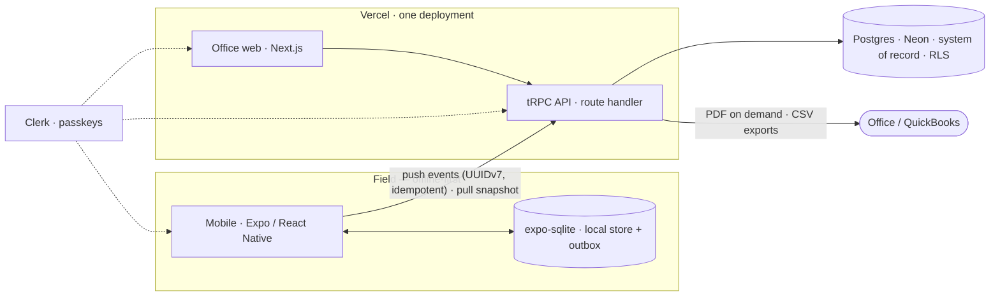

# TRADER — Architecture

What the system is and how it is built. What it does → [PRD.md](PRD.md). How code is written →
[RULES.md](RULES.md). Versions live in the `package.json` files and the lockfile, never here.

## System architecture

A modular monolith: one codebase, one API, one database, one deploy target. Clients never argue
with the server; they send append-only events and snap to server truth on the next sync.



| Piece          | Role                    | Notes                                                                                   |
| -------------- | ----------------------- | --------------------------------------------------------------------------------------- |
| `apps/mobile`  | Field client            | Owns the device store and outbox; works with no signal                                  |
| `apps/web`     | Office client, API host | Next.js serves the office UI and the tRPC route handler both clients call               |
| `packages/api` | The one API             | tRPC routers, request context, role gates, sync boundary; exports `AppRouter` as a type |
| `packages/db`  | Schema and migrations   | Drizzle schema, migrations, seed, invariant tests against a real database               |

## Technology stack

| Layer         | Choice                                                              | Why                                                                    |
| ------------- | ------------------------------------------------------------------- | ---------------------------------------------------------------------- |
| Mobile        | Expo (React Native), EAS builds                                     | One codebase for iOS and Android; managed builds                       |
| Local store   | Drizzle on `expo-sqlite`                                            | Same ORM as the server; storage only — the sync layer is ours          |
| Web + API     | Next.js on Vercel Pro, Node runtime, `iad1`                         | One deployment, one bill; `pg` Pool with `attachDatabasePool`          |
| API           | tRPC + zod + superjson                                              | End-to-end types; validation at every boundary; Dates survive the wire |
| ORM           | Drizzle                                                             | SQL-shaped, TypeScript-native, first-class migrations                  |
| Database      | PostgreSQL — Docker locally, Neon Launch (`aws-us-east-1`) deployed | Plain Postgres only; autoscale 0.25–1 CU, scale-to-zero on             |
| Auth          | Clerk Pro                                                           | Passkeys + email-code fallback; invitation-only; 30-day max session    |
| Observability | Sentry, PostHog                                                     | Errors and product analytics; PII scrubbed before the pilot            |
| Jobs          | Vercel Cron; GitHub Actions for backups                             | No queue to run                                                        |
| Backups       | Nightly encrypted `pg_dump` to Cloudflare R2; weekly restore-verify | Plus a timed restore drill before the pilot                            |
| Secrets       | Vercel env vars, EAS secrets, GitHub Actions secrets                | Each platform holds what it needs; nothing in the repository           |

Rejected: WatermelonDB and PowerSync (sync), SQLCipher (OS encryption plus data minimization
instead), SMS and passwords (auth), a separate backend host, AWS App Runner and ECS. Inngest,
Twilio and Cloudflare Images are adopted only if a task shows them cheaper than the alternative.

## Invariants

Enforced mechanically and tested against a real database. A failing invariant test means the
change is wrong, not the test.

1. `work_session_events` rejects UPDATE, DELETE and TRUNCATE for every role, including the
   application's own connection. Corrections are new events.
2. Event ids are client-generated UUIDv7 and are the idempotency key. The server never
   defaults one; the device never regenerates one on retry.
3. Money is integer minor units paired with a currency code. No floating point anywhere.
4. Every tenant-scoped table has `company_id NOT NULL`, composite foreign keys that carry it,
   and row-level security `ENABLE`d and `FORCE`d, keyed on `app.company_id`.
5. The application role is created in SQL with `NOBYPASSRLS` — never through the Neon console,
   CLI or API — and the server refuses to start under a role that can bypass RLS.
6. Tenant binding happens only through a server-side invitation; no request names a company.
7. Derived values — `work_date`, session state, worked duration — are computed from the event
   fold, never stored. Append-only tables carry no `updated_at`.
8. Schema changes are additive. A destructive migration is a defect.

## Sync protocol

- Capture touches local storage only: no network call and no session check on that path.
- Push: the outbox sends oldest-first in batches. The server upserts by id, validates each
  event against the folded timeline with the event inserted at its `client_timestamp` (the
  check is two-sided: what came before and what comes after must both stay legal), and answers
  per record — `accepted`, `duplicate` (success), or `rejected` (permanent, never retried,
  surfaced as needing attention). Transport failure is not rejection; a record omitted from a
  response is retried.
- Pull: a per-user snapshot of own entries plus reference data. No cursor in V1.
- A cycle is push then pull. Triggers — reconnect, foreground, timer — coalesce so two cycles
  never run at once. A record stuck `syncing` is reclaimed after two minutes.
- Ordering: `client_timestamp`, then `server_timestamp`, then `id`. Device skew is measured per
  push as `|device_now − server_now|` with a 5-minute tolerance; a skewed event is still
  written, ordered by `server_timestamp`, flagged, and routed to approval.
- Versioning on two axes: `schema_version` per event, accepted forever through upcasters; a
  protocol version per request. A server-driven kill switch with four states, from normal
  operation to forced update, ships in build 1; the states are named when it is built.
- Sync bookkeeping — state, attempts, next attempt — stays on the device and is never sent.

## Domain and identifiers

`jpteq.app` is the only domain: the apex serves the web app and the association files, `www`
redirects to the apex, `api.` aliases it, `clerk.` is DNS-only, and the subdomain allowlist is
closed. Passkey rpID `jpteq.app` — irreversible once the first credential exists. Bundle ID and
package name `app.jpteq.trader`.

## Folder structure

```
.
├── .github/workflows/ci.yml   # the one workflow; the required check is its job name
├── apps/
│   ├── mobile/                # Expo field app                      (planned)
│   └── web/                   # Next.js office app + tRPC handler   (planned)
├── packages/
│   ├── api/                   # @trader/api — routers, context, sync (scaffold)
│   └── db/                    # @trader/db — schema, migrations, tests (scaffold)
├── docs/                      # PRD · ARCHITECTURE · RULES · DESIGN · TASKS · MEMORY
├── CLAUDE.md                  # Claude Code session contract (auto-loaded)
├── LICENSE
└── README.md
```

Inside a package: `src/` for code, `test/` for tests, a `README.md` only when it owns a runbook
nothing else owns. `packages/db/src/schema/` holds one file per table group.

## Decisions

One line each; the date is when it was settled. A change is a new row naming the row it
supersedes, never an edit to an old row.

| Date       | Decision                                                                             | Supersedes                        |
| ---------- | ------------------------------------------------------------------------------------ | --------------------------------- |
| 2026-07    | Modular monolith; the API runs inside the Next.js deployment on Vercel               | Separate backend host             |
| 2026-07    | Build the sync layer; Drizzle on `expo-sqlite` for storage only                      | WatermelonDB                      |
| 2026-07    | Append-only labor log, client UUIDv7 ids, integer cents, derived values never stored | —                                 |
| 2026-07    | Biometric attestation on clock actions, never blocking                               | —                                 |
| 2026-10    | Snapshot pull, no cursor in V1                                                       | Keyset cursor (2026-07)           |
| 2026-10    | RLS from the first migration; app role created in SQL with `NOBYPASSRLS`             | RLS deferred to the second tenant |
| 2026-10    | Payments out of V1; invoices `draft → issued → void`, credit memos, QuickBooks CSV   | Stripe in V1 (2026-07)            |
| 2026-10    | Passkeys with email-code fallback; no SMS, no passwords                              | Phone-number recovery (2026-07)   |
| 2026-10    | Office-approval rule for offline, edited, user-timed and location-flagged entries    | —                                 |
| 2026-10    | Foreground location stamps at clock events only; geofenced clock-in dropped          | Advisory geofence spike (2026-07) |
| 2026-10    | Effective-dated pay rates; immutable closed pay periods; no pay calculation in V1    | Open                              |
| 2026-10    | `jpteq.app` everywhere; bundle ID `app.jpteq.trader`                                 | `jpteq.com`                       |
| 2026-10    | Vercel Pro, Neon Launch and Clerk Pro from the first production instance             | Open hosting decision             |
| 2026-10    | Nightly `pg_dump` to R2 with weekly restore-verify                                   | —                                 |
| 2026-10    | Web approval by push, Expo push, Inngest and Resend deferred past V1                 | Phase 3–4 plans (2026-07)         |
| 2026-10-13 | Rebuild from `archive/pre-rebuild`; six-doc set replaces the previous documentation  | 2026-07 doc set and ADR register  |
