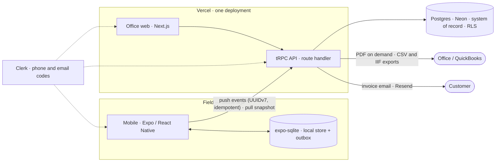

# TRADER — Architecture

What the system is and how it is built. What it does → [PRD.md](PRD.md). How code is written →
[RULES.md](RULES.md). Versions live in the `package.json` files and the lockfile, never here.

## System architecture

A modular monolith: one codebase, one API, one database, one deploy target. Clients never argue
with the server; they send append-only events and snap to server truth on the next sync.



| Piece          | Role                    | Notes                                                                                   |
| -------------- | ----------------------- | --------------------------------------------------------------------------------------- |
| `apps/mobile`  | Field client            | Owns the device store and outbox; works with no signal                                  |
| `apps/web`     | Office client, API host | Next.js serves the office UI and the tRPC route handler both clients call               |
| `packages/api` | The one API             | tRPC routers, request context, role gates, sync boundary; exports `AppRouter` as a type |
| `packages/db`  | Schema and migrations   | Drizzle schema, migrations, seed, invariant tests against a real database               |

## Technology stack

| Layer         | Choice                                                              | Why                                                                       |
| ------------- | ------------------------------------------------------------------- | ------------------------------------------------------------------------- |
| Mobile        | Expo (React Native), EAS builds                                     | One codebase for iOS and Android; managed builds                          |
| Local store   | Drizzle on `expo-sqlite`                                            | Same ORM as the server; storage only — the sync layer is ours             |
| Web + API     | Next.js on Vercel Pro, Node runtime, `iad1`                         | One deployment, one bill; `pg` Pool with `attachDatabasePool`             |
| API           | tRPC + zod + superjson                                              | End-to-end types; validation at every boundary; Dates survive the wire    |
| ORM           | Drizzle                                                             | SQL-shaped, TypeScript-native, first-class migrations                     |
| Database      | PostgreSQL — Docker locally, Neon Launch (`aws-us-east-1`) deployed | Plain Postgres only; autoscale 0.25–1 CU, scale-to-zero on                |
| Auth          | Clerk Pro                                                           | SMS code (crew), email code (office); invitation-only; 30-day max session |
| Observability | Sentry, PostHog                                                     | Errors and product analytics; PII scrubbed before the pilot               |
| Jobs          | Vercel Cron; GitHub Actions for backups                             | No queue to run                                                           |
| Backups       | Neon point-in-time restore in Release 0.1; `pg_dump` to R2 after it | A timed restore drill before the crew starts                              |
| Email         | Resend                                                              | Invoice delivery only                                                     |
| Secrets       | Vercel env vars, EAS secrets, GitHub Actions secrets                | Each platform holds what it needs; nothing in the repository              |

Rejected: WatermelonDB and PowerSync (sync), SQLCipher (OS encryption plus data minimization
instead), passwords (auth), a separate backend host, AWS App Runner and ECS. Inngest,
Twilio and Cloudflare Images are adopted only if a task shows them cheaper than the alternative.

## Invariants

Enforced mechanically and tested against a real database. A failing invariant test means the
change is wrong, not the test.

1. `work_session_events` rejects UPDATE, DELETE and TRUNCATE for every role, including the
   application's own connection. Corrections are new events.
2. Event ids are client-generated UUIDv7 and are the idempotency key. The server never
   defaults one; the device never regenerates one on retry.
3. Money is integer minor units paired with a currency code. No floating point anywhere.
4. Every tenant-scoped table has `company_id NOT NULL`, composite foreign keys that carry it,
   and row-level security `ENABLE`d and `FORCE`d, keyed on `app.company_id`.
5. The application role is created in SQL with `NOBYPASSRLS` — never through the Neon console,
   CLI or API — and the server refuses to serve under a role that can bypass RLS: the check
   runs in every protected transaction, on the connection that transaction holds.
6. Tenant binding happens only through a server-side invitation; no request names a company.
7. Derived values — `work_date`, session state, worked duration — are computed from the event
   fold, never stored. Append-only tables carry no `updated_at`.
8. Schema changes are additive: no migration drops a table, a column or data. Relaxing a
   constraint, or withdrawing a privilege from the application role, is allowed when its
   decision row says why. A destructive migration is a defect.

## Sync protocol

- Capture touches local storage only: no network call and no session check on that path.
- Push: the outbox sends oldest-first in batches. The server takes each record in its own
  transaction, upserts by id, validates each event against the folded timeline with the event
  inserted at its effective instant (the check is two-sided: what came before and what comes
  after must both stay legal), and answers per record — `accepted`, `duplicate` (success), or
  `rejected` (permanent, never retried, surfaced as needing attention). Transport failure is not
  rejection; a record omitted from a response is retried.
- Pull: a per-user snapshot of own entries plus reference data. No cursor in V1.
- A cycle is push then pull. Triggers — reconnect, foreground, timer — coalesce so two cycles
  never run at once. A record stuck `syncing` is reclaimed after two minutes.
- Ordering: `client_timestamp`, then `server_timestamp`, then `id`. Device skew is measured per
  push as `|device_now − server_now|` with a 5-minute tolerance; a skewed event is still
  written, flagged, and routed to approval.
- A suspicious time is reviewed, never replaced (V1-D01). The event's effective instant is the
  `client_timestamp` it was captured with, flagged or not; `clock_skewed` is evidence and an
  approval reason, and a person decides. The fold (`labor/fold.ts`, `effectiveAt`) and the
  closeout's day query read `client_timestamp` alone; the review fingerprint is `v2.`, and a
  `v1.` value is `review_stale`.
- Event time is judged by the server as well as asserted by the device. A labor event's
  receipt is the `server_timestamp` it is stored with. An event that claims it was captured
  online at the time it carries — not captured offline, not timed by the user — yet precedes
  its receipt by more than the tolerance is flagged `clock_skewed` and goes to approval at its
  captured time; an event timed later than its receipt by more than the tolerance, whatever
  it claims, is rejected `time_in_future`. Exactly the tolerance is neither. `clock_skewed`
  is that verdict or the per-push reading; `clock_skew_ms` is the per-push reading alone. The
  rejection writes nothing, so the ledger and every closeout are untouched; the record stays
  on the phone under its id, shown as needing attention, and the office recovers the hours
  through `labor.repair`. Receipts (materials) are not compared.
- `captured_offline` is true unless the device held a confirmed, fresh API reachability
  reading when the record was captured; unknown, absent or stale is offline (V1-D02). Capture
  reads the last reading and never waits for a probe. Delivery delay is not the test. The
  device records the flag; the server check above is what keeps a false "online" from skipping
  approval. The reading and its staleness bound are the device's, built in Stage 5.
- Rejected-record diagnostics (V1-D04): a push leaves minimized lines in `sync_diagnostics`
  for what the server refused or did not process. A line holds the request id, the record's id
  and kind where they could be read, an outcome, a code, the caller's user id and company id,
  and the database's receipt time — never the payload, a location, the record's own time, an
  email or an error's text. The user is who sent the push: a foreman's push for a crew member
  is the foreman's, because the subject is in the payload, which is never read for this. A
  record id is a UUIDv7 and so carries the device's clock at minting; it is kept as an id and
  never read as a time.
  - Outcomes: `rejected`, with the code the record was answered (`invalid_record` and
    `not_permitted` included); `omitted` — `record_failed` for a record that threw after an
    earlier one ran, `unreadable_record` (no record id) or `unknown_schema_version` for a
    record the batch stopped on, `not_attempted` for each record behind either whose id can be
    read; `request_failed`, one line naming no record, with tRPC's code, for a call that failed
    as a whole. An accepted record, a duplicate, and records left out because the batch budget
    ran out leave nothing: the last is not a failure.
  - The lines are written after the call has settled, in one more caller transaction (lock
    1 s, statement 2 s), awaited before the answer returns. That transaction resolves a caller
    who is already bound and never performs a first sign-in. Whatever it throws is reported
    (`source: diagnostics`) and dropped: no answer changes, and no committed record is undone.
    Lines are therefore best-effort: lost if the write fails or the process dies first.
  - Nothing is written for a caller who cannot be resolved — anonymous, uninvited, never
    signed in, deactivated — including lines for records refused earlier in that request;
    nor for a request refused before the procedure runs (too many calls, a context that
    cannot be built). A record that never reached the server leaves nothing: the device's
    outbox is the durable copy and the only recovery path, and a line never says a write
    committed.
  - One line per record and code: a record re-sent and refused the same way keeps its first
    line and its first request id. A line with no record id repeats per attempt. A caller
    leaves at most 1,000 lines in 24 hours; past that they are dropped.
  - Retention is 30 days. Each write first deletes up to 500 of the company's expired lines,
    and `diagnostic.list` never returns one. A company that writes no new line keeps its
    expired rows, unread, until the daily delete (to be built, TASKS Stage 6). Backups and
    database history keep a deleted line for their own windows.
  - `diagnostic.list`, admin only: one sender's lines received on one calendar day in
    `companies.timezone`, newest first, at most 200. The day is the day of receipt, not the
    day worked. The office screen is `/refusals`.
  - One request id per HTTP request, made by the route handler and never read from the client,
    shared by every call in a batch, carried by the context, the error report and each line;
    it is not returned to the client.
- Versioning on two axes: `schema_version` per event, accepted forever through upcasters; a
  protocol version per request.
- Sync bookkeeping — state, attempts, next attempt — stays on the device and is never sent.
- The pull snapshot grows by optional fields within protocol 1, which clients ignore when they
  do not know them; a new protocol version is for a change in meaning. The snapshot is derived
  per request and carries no `schemaVersion`. The extension (V1-D12; to be built, Stage 5)
  adds, each scoped to what the caller may already act on: coordinates and detection radius of
  the jobs the caller may start on; those jobs' customer name; the caller's own dated
  assignments; the stored approval reasons of the caller's own entries. Nothing of another
  worker's, no cost, no rate, no contact detail. With the weekly schedule (to be built,
  TASKS S4 and S7) it also says whether schedule enforcement is on and gives each of the
  caller's own shifts its eligible hours, worked out by the server; under enforcement the
  jobs a worker may start on are those of their eligible shifts.

### Operational sync states

`status.get`, public, ships in build 1 and answers the state below. No state stops capture or
drops a record.

| State             | Push                        | Pull                        |
| ----------------- | --------------------------- | --------------------------- |
| `normal`          | Allowed                     | Allowed                     |
| `read_only`       | Temporarily restricted      | Allowed                     |
| `paused`          | Temporarily restricted      | Temporarily restricted      |
| `update_required` | Restricted until compatible | Restricted until compatible |

The server enforces the state, not only the client (V1-D21; to be built, TASKS Stage 6).
Today the state is advisory: `sync.push` and `sync.pull` never read it, and only a
cooperative client obeys. When built:

- A restricted call answers one stable, retryable result that names the state. It is a
  transport-level answer about the service, never a per-record `rejected`: no record is
  marked permanent, needing attention or failed because of it.
- The state is read at a transaction boundary. A push checks before each record's
  transaction and never inside one, so a record is wholly written or not started; a batch
  interrupted by a change of state returns the results so far and omits the rest, which the
  client retries as it retries any omitted record.
- A client that meets a restricted answer keeps its outbox, every event id and every captured
  record, stops sending, and tries again after a fresh `status.get`; under `update_required`
  it keeps capturing and tells the user to update.
- The states, their meanings, `status.get` and protocol 1 are unchanged.

## Office authority

Each rule's decision row carries the detail; rows marked to be built name their TASKS stage.

- **Roles.** A worker writes own labor and receipts under push authority, reads own entries
  through `sync.pull`, and writes own `name` and `phone` (`me.update`). No role has an UPDATE
  path on a ledger row; a correction is an appended row. A foreman's authority is the crews
  they lead. An admin's is the company: bounded by RLS, by every append-only and frozen-row
  guard, and by the decision rules below (V1-D11).
- **Identity.** An invitation binds one person and nobody shares an account. A crew member
  signs in with a code sent by SMS to their own phone number; an office admin with a code
  sent to their own email address, or to their number (2026-11-12 Release 0.1 sign-in). A
  user row carries a sign-in address — `sign_in_phone`, `email`, or both, each unique per
  company — and the first sign-in the provider verified for either binds the one unbound
  invitation that names it; anything but exactly one binds nothing (2026-11-12 phone
  identity). Every invitation names a number, and may name an email (2026-11-12 a sign-in
  number on every new invitation). `phone` is contact data and identifies nobody. The
  provider is Clerk: its adapter reads the address claims of a session Clerk verified, and
  `roster.invite` creates the person's Clerk user (2026-11-12 Clerk behind the identity
  seam; invitation at the provider). The development adapter answers only where its flag
  and `NODE_ENV` admit it, never in a production build.
- **Dated assignments.** As built, and the rule while schedule enforcement is off (Weekly
  schedule, below). An admin assigns any active user to any job of the company that is
  not archived, whatever the person's crew membership or role. An assignment is never read by
  push authority, validation, the fold, approvals, closeouts, pay or invoices, creates no
  `crew_members` row, and widens no read. Its day is a calendar day in `companies.timezone`
  and its expected start and end are wall-clock times on that day, kept as written and never
  turned into an instant or a duration. The office read derives, per assignment, whether
  push authority would admit that person on that job now, and reports what stands in the
  way; a person reads their own assignments and nobody else's, each with its job's name and
  address — the one thing a plan shows them that their crews' jobs might not (V1-D07).
- **Weekly schedule** (to be built, TASKS S1 to S9; the 2026-11-15 rows, which carry the
  detail). The dated assignment becomes a shift: one person, one job, one calendar day in
  `companies.timezone`, a start and an end on that day's wall clock, the start included
  and the end excluded. Only an admin writes one. A person may have several in a day, on
  one job or on several; an exact duplicate is refused, and an overlap is refused unless
  an admin overrides it with a reason and names the shift that holds the shared time.
  Every write is judged over the person's whole day: at each scheduled moment exactly one
  shift is eligible, so a circular, missing or ambiguous precedence is refused, and so is
  a shift left with no eligible time. A start is also admitted up to 15 minutes before the
  shift that becomes eligible next that day, while no shift is eligible. Once a start has
  been admitted on a shift its job, day and times never change and it is never removed,
  and no other write may alter what authorized that start; attendance is corrected in the
  labor ledger, never in the schedule. An override's creation, change and removal each
  leave an entry nothing can edit or delete. A week is Monday to Sunday; Copy Last Week
  previews, is confirmed, writes in one transaction or not at all, copies no override, and
  is undone whole or not at all. Enforcement is a server-controlled switch, off by
  default, turned on in production by the owner's separate approval and on staging by a
  session once the server's and the phone's tests pass: off, clock-in authority is the
  crew's, as built; on, a worker's or a foreman's own `started` needs their eligible shift
  and no crew membership, a foreman's `started` for a crew member needs that member's
  eligible shift and the foreman's authority as it is today, an admin's own needs none,
  and pause, resume, end and receipts are judged as they are today. A shift is planned
  time: it is never hours, pay or cost.
- **Admin closeout.** `closeout.review` and `closeout.submit` also
  admit an admin, for any job of the company — archived or with no crew included — with the
  input, answers, own-id-first retry, fingerprint, field-write lock and lock order unchanged.
  The foreman path is as today: the job's current crew's foreman, a crew-less job refused. An
  archived job's status is still never written by a closeout (V1-D08).
- **Material cost.** An admin states what a logged receipt cost — the receipt total in
  integer cents with its currency — and replaces or clears it at any time. It is the one write
  to a receipt after it is logged and names only `cost_cents` and `currency`: a closed-out
  member and an after-closeout receipt are frozen but for those two. Cost is no approval
  subject and is in no review, fingerprint or correction; a receipt is priced whatever its
  standing, and whether it counts is derived with job cost.
- **Office material entries.** An admin inserts a receipt the crew never logged, through
  `material.create`, for any job of the company, archived included. The row records that it
  is office-originated (`materials.entered_by_office`) and who entered it (its logger is that
  admin) — stored provenance, not inferred from the logger's role; a device push can never
  state it. The office names a calendar day, not a moment: `logged_at` is noon of that day on
  the wall clock of `companies.timezone`, and a day after today there is refused. It is a new
  row under the field-write lock and the ordinary receipt rules: on an open day it counts as
  a clean device receipt does and the day's closeout review shows it; on a closed-out day it
  is `after_closeout`, pending, and never decided by the admin who entered it. It never
  updates a logged, sealed or frozen receipt; those change only through `material.correct`
  (V1-D09).
- **Deciding approvals.** Implemented: a receipt's logger and a correction's submitter never
  decide their own row, and a labor event's worker never decides that event (API and SQL);
  the admin who wrote a repair for another person may decide it. An admin's own labor needs
  no approval (V1-D10 as amended): no approvals row is written for an event whose worker is
  an admin at receipt unless a different admin wrote it — their own push, a foreman's push
  for them, their repair of their own ledger; the evidence columns are stored as for anyone,
  and with no row the event is approved by default. Receipts and material corrections are
  unchanged, and so is a repair of another person's labor, another admin's included. A role
  change after receipt moves nothing: a row that exists stays, and stays its worker's not to
  decide.
- **Worker ledger.** `labor.ledger` gives an admin one person's sessions for a range of
  work dates with every event behind each — the sources in effect, the ones a correction
  replaced, a void — the evidence each was stored with, its approval as stored, and the
  session's accounting, derived by the fold and the approval accounting and never a second
  way. It reads; it writes nothing, takes no lock and leaves no audit row. It is the read
  `labor.repair` takes its event ids from.
- **Audit trail.** `audit_log` rows are written by the invitation, role, activation and
  deactivation, and pay-rate writers, by `labor.repair` and by `approval.decide` — nothing
  else. Each row carries the actor, the company, the action, the entity and the fields that
  changed, and is inserted in the transaction of the write it records, so a rolled-back write
  leaves no row and a committed one always has its row. No request-level or generic write
  interception; no snapshot of a column the action did not change (V1-D20). One writer,
  `core/audit.ts`, called by each of those procedures on the branch that changes something:
  a repeat, a refusal and a duplicate leave no row, and a failed insert fails the call. The
  actions are `users.invite`, `users.set_role`, `users.deactivate`, `users.reactivate`,
  `pay_rates.add`, `work_session_events.repair` and `approvals.decide`. The actor and the
  company are the resolved caller's, never an input's; the stamp is the server's clock at the
  insert. Nothing reads the table through the API. To be built with the weekly schedule
  (TASKS S2, S3): the history of overlap overrides — created, changed, removed — which
  outlives the override and the shifts it names; whether it is kept here or in a store of
  its own is S2's plan.

## Accounting and exports

Hours, job cost and pay periods are built. Of the payroll CSV, invoices and their exports
only the tables and their guards exist. The Release 0.1 track takes the payroll CSV,
invoice drafting, issue, void, the PDF and a plain CSV of issued invoices; Stage 7 builds
the QuickBooks exports and credit memos.

- **Rounding.** Durations are summed in milliseconds per worker, job and work date; that
  daily total is rounded half-up to 0.01 h. Approved-hours accounting, job cost, the payroll
  CSV and the quantity of an invoice line drawn from labor read that one figure from one
  derivation. Ledger rows are never rounded; money stays integer cents (V1-D13). The
  derivation is `labor/hours.ts`, read from the database by `readDayHours`
  (`labor/day-hours.ts`) and by nothing else; hours travel as integer hundredths. A total of
  hours — a person's, a range's — is the sum of rounded cells, added on the server and never
  rounded again; no client adds or rounds.
- **What is in a figure.** Approved hours are the worked milliseconds of sessions that count
  (approval accounting) and have ended. A session that counts but has no clock-out adds
  nothing until it ends; pending and rejected sessions add nothing; each is reported beside
  the figure, never inside it.
- **Job cost to date.** Each worker's rounded hours on the job on a work date, times the
  rate in force that day, rounded half-up to the cent; labor cost is the sum of those lines.
  Materials are the stored totals of the receipts that count and are priced. Totals are per
  currency and never added across two. Beside the total and in none: approved hours with no
  rate in force on their day, pending labor and receipts, and receipts that count but are
  not priced. It is derived per request and never stored; it informs the office and is
  neither a price (V1-D14) nor a pay calculation.
- **Pay periods.** An inclusive range of 1 to 31 work dates. The first may start anywhere;
  every later one starts the day after the latest ends. Only the latest period's dates may
  be changed, and only while it is open. Periods close in order, and not before their last
  day has passed in `companies.timezone`.
- **Pay-period close.** A period closes with approvals still pending in it once the caller
  has acknowledged them. The acknowledgment is part of the close call: the counts of sessions
  on the period's dates that wait for approval and of sessions that count but have no
  clock-out, as the caller was shown them. The server counts both again under its lock; a
  close with something unresolved and no acknowledgment, or one whose counts differ, writes
  nothing and answers the counts as they stand. The counts judged are kept on the closed
  row. A closed period and what it exported are frozen (V1-D03).
- **Late adjustments.** Hours approved, corrected or repaired after their period closed are
  exported once, as adjustment lines in the next period to close, each carrying its original
  work date and the signed difference from what earlier closed periods exported for that
  worker, job and date. The basis for "already exported" is stored at close, so an adjustment
  is derived deterministically, appears in exactly one period, and no closed export is
  recomputed. The basis is `pay_period_lines`: one append-only row per worker, job and work
  date in hundredths of an hour, written only by the transaction that closes its period —
  the period's own hours on its dates, an adjustment on an earlier one. At a close, the
  approved figure of the one derivation minus the sum of every stored line for the same
  worker, job and date is the line written; a day in no closed period is never adjusted.
  Membership is the close's one read of the ledger: nothing is compared with `closed_at`,
  and the close holds up no push and no decision. No rate is read, so a rate dated inside a
  closed period changes job cost to date and nothing a close stored.
- **Invoice pricing.** A draft line's `unit_price_cents` is entered by an admin. A line may
  take its description and quantity from job labor or a material as a snapshot; no rule
  derives a price from a pay rate or a receipt's cost. Issue freezes the lines (V1-D14).
- **Credit and void.** The sum of an invoice's credit memos never exceeds its total as
  issued; an invoice with a memo cannot be voided; numbering and the issue lock are as the
  2026-11-03 rows state (V1-D15).
- **Payments and delivery (to be built, Release 0.1 track R7).** The office records what a
  customer paid against an issued invoice — amount, date, method, a note; TRADER captures and
  processes nothing. What is owed and whether an invoice is paid are derived from the
  recorded payments and the invoice's total, never stored as a status. An issued invoice's
  PDF is sent to the customer by email when an admin chooses, and each send is recorded. The
  tables, their guards and the money rules are R7's plan (2026-11-12 Release 0.1 invoicing).
- **Exports.** One authoritative snapshot — the issued invoice and its frozen lines, or the
  closed period's approved hours — and independent adapters over it, none of which writes:
  QuickBooks Online invoice CSV, QuickBooks Desktop invoice IIF, payroll-hours CSV, and the
  full data export. Each adapter's columns are checked against Intuit's current import
  documentation when it is built, never recalled. What an edition's import does not support
  (some tax configurations, credit memos) is not exported as if it were: the export screen
  gives the figures and the manual entry and reconciliation steps (DESIGN). No payroll
  processing, no accounting API, no automatic synchronization (V1-D16, V1-D18, V1-D19).

## Concurrency

One global lock order, so no two writers can wait on each other:

1. `jobs` rows, 2. `customers` rows, 3. `crews` rows, 4. `users` rows in id order (the caller
   re-read among them, `lockActiveSelf`), 5. `companies` row, 6. the company's field-write
   advisory lock (shared by every labor and material writer, exclusive for a closeout), 7. the
   worker's advisory lock, 8. `materials` rows, 9. the `approvals` row, 10. `job_assignments`
   rows, 11. the company's pay-period advisory lock (`lock_pay_periods`: every opener,
   mover and closer of a period), 12. `pay_periods` rows.

A holder of the field-write lock takes no row lock on the first five beyond foreign-key
`KEY SHARE`. Every stamp that must sort after a lock is read from the server's clock after
that lock (`core/clock.ts`), never from `now()`. The one known inversion is a first sign-in's
bind, which holds the caller's `users` row `FOR UPDATE`; Postgres aborts one side and the call
is retried.

## Runtime bounds

| Bound                         | Value                          | Where                                  |
| ----------------------------- | ------------------------------ | -------------------------------------- |
| Pool size per server instance | `DATABASE_POOL_MAX`, 10        | `packages/db/src/env.ts`               |
| Wait for a free connection    | 5 s                            | `packages/db/src/client.ts`            |
| Protected call                | lock 5 s, statement 20 s       | `packages/api/src/core/trpc.ts`        |
| Push record                   | lock 2 s, statement 4 s        | `packages/api/src/core/trpc.ts`        |
| Push batch                    | 100 records, none after 8 s    | `packages/api/src/sync/push.ts`        |
| Diagnostics write             | lock 1 s, statement 2 s        | `packages/api/src/sync/diagnostics.ts` |
| Diagnostic lines per caller   | 1,000 in 24 h                  | `packages/api/src/sync/diagnostics.ts` |
| Diagnostic retention          | 30 days, 500 deleted per write | `packages/api/src/sync/diagnostics.ts` |
| Calls per HTTP request        | 10                             | `apps/web/src/server/handler.ts`       |
| Client-asserted instant       | 0001-01-01 to 9999-12-31       | `packages/api/src/core/instant.ts`     |

An idle pooled connection that the server drops is logged by class and SQLSTATE and discarded;
it never ends the process.

## Before the first deployment

Each is a line in TASKS Stage 6 and a release gate in Stage 8; the Release 0.1 track in TASKS
names the ones it takes and the ones it leaves for after it. Those marked built exist in
code (the 2026-11-12 Release 0.1 R3 rows) and are proven only when the staging deployment
has shown them; the rest do not exist yet.

- Production identity: a Clerk production instance on the paid plan, its DNS records and its
  keys in the deployment. The adapter and the invitation are built, and a production build
  never consults the development adapter (2026-11-12 Clerk behind the identity seam).
- The deployed login role is `trader_app` itself, verified on the deployed database: not a
  superuser, no `BYPASSRLS`. Built: `GET /api/ready` asserts it on a pooled connection.
- Rate limits per identity and per address in front of the API; a request body limit.
- An `Origin` check on state-changing requests, and session-cookie attributes decided with the
  identity provider.
- A content security policy and transport security, tested against the deployed app. Built:
  the policy per request in `apps/web/src/proxy.ts`; transport security beside the baseline
  headers (`nosniff`, frame denial, referrer policy) in `apps/web/next.config.ts`.
- Server-enforced sync states (Sync protocol, Operational sync states): until it is built the
  state is advisory and cannot stop a client that ignores it.
- A readiness check that touches the database and the role; environment validated at start.
  Built: `/api/ready`, and the start-up check in `apps/web/src/server/deploy-env.ts`.
- Backups, a rehearsed restore, and a written migrate-and-rollback procedure. Written:
  `packages/db/README.md`. Rehearsed on staging on 2026-11-14 as an isolated recovery: a
  branch made from a past instant of the default branch answered its first query 4 s
  after the command, holding the data as it stood at that instant, on a database of one
  company. Not rehearsed: a restore of a default branch in place, a deployment pointed at
  restored state, and recovery of a database of working size.
- An error reporter that keeps the minimized event and sends nothing else. Built:
  `apps/web/src/server/reporter.ts` and `sentry-event.ts`.
- A daily delete of expired `sync_diagnostics` lines in every company: until it runs, a
  company that leaves no new line keeps its expired ones on disk.

## Domain and identifiers

`jpteq.app` is the only domain, and one Vercel deployment answers on all of it:
`app.jpteq.app` serves the office and the API at `/api/trpc`, which is the origin the field
app calls; the apex serves the public pages — privacy policy, terms, support, the
account-deletion request — and `www` redirects to it; `clerk.` is DNS-only; the subdomain
allowlist is closed. No `api.` host exists. Bundle ID and package name `app.jpteq.trader`.

## Folder structure

The root holds `.github/workflows/ci.yml` (the one workflow; its job name is the required check),
`assets/brand/` (`logo.png`, `icon.png`; DESIGN, Brand), `apps/` and `packages/` (System architecture
table), `docs/` (the seven documents), `CLAUDE.md`, `LICENSE` and `README.md`.

```text
apps/web/src/app/        office screens, shared UI modules, strings, theme
apps/web/src/server/     the route handler, the pool, the identity seam and directory
apps/web/src/proxy.ts    Clerk's request proxy: verifies a session, protects no route
packages/api/src/core/   request plumbing: context, tRPC and the caller transaction, identity,
                         user resolution, error reporting, kill switch, locks, clock, instants
packages/api/src/<domain>/   approvals, closeout, crews, customers, jobs, labor, materials,
                         roster, sync, demo — pure cores and writers, one concern per file
packages/api/src/routers/    one thin router per namespace; `router.ts` composes them
packages/db/src/schema/  one Drizzle file per table group
packages/db/migrations/  the journal; hand-written SQL in `generate --custom` files
packages/*/test/         mirrors `src/` by folder; `helpers.ts` and `setup.ts` at its root
```

## Decisions

The decisions, one line each as they were made, are in [LOG.md](LOG.md) under their days. Until
TASKS line O9b is done, the log is the only statement of the rules in force that the body
above does not state.
