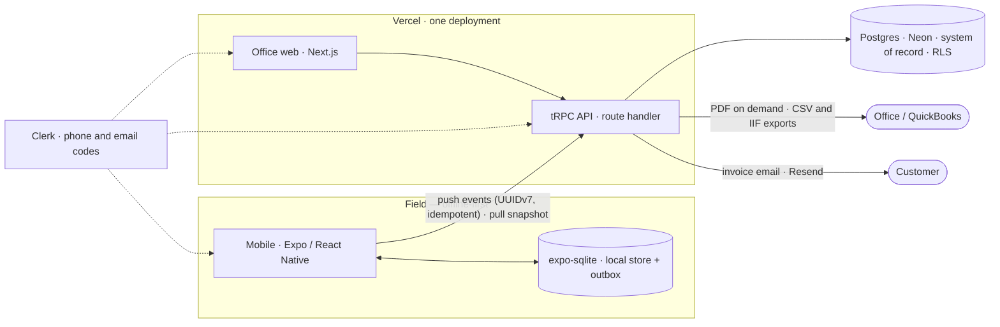

# TRADER — Architecture

What the system is and how it is built. What it does → [PRD.md](PRD.md). How code is written →
[RULES.md](RULES.md). Versions live in the `package.json` files and the lockfile, never here.

## System architecture

A modular monolith: one codebase, one API, one database, one deploy target. Clients never argue
with the server; they send append-only events and snap to server truth on the next sync.



| Piece          | Role                    | Notes                                                                                   |
| -------------- | ----------------------- | --------------------------------------------------------------------------------------- |
| `apps/mobile`  | Field client            | Owns the device store and outbox; works with no signal                                  |
| `apps/web`     | Office client, API host | Next.js serves the office UI and the tRPC route handler both clients call               |
| `packages/api` | The one API             | tRPC routers, request context, role gates, sync boundary; exports `AppRouter` as a type |
| `packages/db`  | Schema and migrations   | Drizzle schema, migrations, seed, invariant tests against a real database               |

## Technology stack

| Layer         | Choice                                                              | Why                                                                       |
| ------------- | ------------------------------------------------------------------- | ------------------------------------------------------------------------- |
| Mobile        | Expo (React Native), EAS builds                                     | One codebase for iOS and Android; managed builds                          |
| Local store   | Drizzle on `expo-sqlite`                                            | Same ORM as the server; storage only — the sync layer is ours             |
| Web + API     | Next.js on Vercel Pro, Node runtime, `iad1`                         | One deployment, one bill; `pg` Pool with `attachDatabasePool`             |
| API           | tRPC + zod + superjson                                              | End-to-end types; validation at every boundary; Dates survive the wire    |
| ORM           | Drizzle                                                             | SQL-shaped, TypeScript-native, first-class migrations                     |
| Database      | PostgreSQL — Docker locally, Neon Launch (`aws-us-east-1`) deployed | Plain Postgres only; autoscale 0.25–1 CU, scale-to-zero on                |
| Auth          | Clerk Pro                                                           | SMS code (crew), email code (office); invitation-only; 30-day max session |
| Observability | Sentry, PostHog                                                     | Errors and product analytics; PII scrubbed before the pilot               |
| Jobs          | Vercel Cron; GitHub Actions for backups                             | No queue to run                                                           |
| Backups       | Neon point-in-time restore in Release 0.1; `pg_dump` to R2 after it | A timed restore drill before the crew starts                              |
| Email         | Resend                                                              | Invoice delivery only                                                     |
| Secrets       | Vercel env vars, EAS secrets, GitHub Actions secrets                | Each platform holds what it needs; nothing in the repository              |

Rejected: WatermelonDB and PowerSync (sync), SQLCipher (OS encryption plus data minimization
instead), passwords (auth), a separate backend host, AWS App Runner and ECS. Inngest,
Twilio and Cloudflare Images are adopted only if a task shows them cheaper than the alternative.

## Invariants

Enforced mechanically and tested against a real database. A failing invariant test means the
change is wrong, not the test.

1. `work_session_events` rejects UPDATE, DELETE and TRUNCATE for every role, including the
   application's own connection. Corrections are new events.
2. Event ids are client-generated UUIDv7 and are the idempotency key. The server never
   defaults one; the device never regenerates one on retry.
3. Money is integer minor units paired with a currency code. No floating point anywhere.
4. Every tenant-scoped table has `company_id NOT NULL`, composite foreign keys that carry it,
   and row-level security `ENABLE`d and `FORCE`d, keyed on `app.company_id`.
5. The application role is created in SQL with `NOBYPASSRLS` — never through the Neon console,
   CLI or API — and the server refuses to serve under a role that can bypass RLS: the check
   runs in every protected transaction, on the connection that transaction holds.
6. Tenant binding happens only through a server-side invitation; no request names a company.
7. Derived values — `work_date`, session state, worked duration — are computed from the event
   fold, never stored. Append-only tables carry no `updated_at`.
8. Schema changes are additive: no migration drops a table, a column or data. Relaxing a
   constraint, or withdrawing a privilege from the application role, is allowed when its
   decision row says why. A destructive migration is a defect.

## Sync protocol

- Capture touches local storage only: no network call and no session check on that path.
- Push: the outbox sends oldest-first in batches. The server takes each record in its own
  transaction, upserts by id, validates each event against the folded timeline with the event
  inserted at its effective instant (the check is two-sided: what came before and what comes
  after must both stay legal), and answers per record — `accepted`, `duplicate` (success), or
  `rejected` (permanent, never retried, surfaced as needing attention). Transport failure is not
  rejection; a record omitted from a response is retried.
- Pull: a per-user snapshot of own entries plus reference data. No cursor in V1.
- A cycle is push then pull. Triggers — reconnect, foreground, timer — coalesce so two cycles
  never run at once. A record stuck `syncing` is reclaimed after two minutes.
- Ordering: `client_timestamp`, then `server_timestamp`, then `id`. Device skew is measured per
  push as `|device_now − server_now|` with a 5-minute tolerance; a skewed event is still
  written, flagged, and routed to approval.
- A suspicious time is reviewed, never replaced (V1-D01). The event's effective instant is the
  `client_timestamp` it was captured with, flagged or not; `clock_skewed` is evidence and an
  approval reason, and a person decides. The fold (`labor/fold.ts`, `effectiveAt`) and the
  closeout's day query read `client_timestamp` alone; the review fingerprint is `v2.`, and a
  `v1.` value is `review_stale`.
- Event time is judged by the server as well as asserted by the device. A labor event's
  receipt is the `server_timestamp` it is stored with. An event that claims it was captured
  online at the time it carries — not captured offline, not timed by the user — yet precedes
  its receipt by more than the tolerance is flagged `clock_skewed` and goes to approval at its
  captured time; an event timed later than its receipt by more than the tolerance, whatever
  it claims, is rejected `time_in_future`. Exactly the tolerance is neither. `clock_skewed`
  is that verdict or the per-push reading; `clock_skew_ms` is the per-push reading alone. The
  rejection writes nothing, so the ledger and every closeout are untouched; the record stays
  on the phone under its id, shown as needing attention, and the office recovers the hours
  through `labor.repair`. Receipts (materials) are not compared.
- `captured_offline` is true unless the device held a confirmed, fresh API reachability
  reading when the record was captured; unknown, absent or stale is offline (V1-D02). Capture
  reads the last reading and never waits for a probe. Delivery delay is not the test. The
  device records the flag; the server check above is what keeps a false "online" from skipping
  approval. The reading and its staleness bound are the device's, built in Stage 5.
- Rejected-record diagnostics (V1-D04): a push leaves minimized lines in `sync_diagnostics`
  for what the server refused or did not process. A line holds the request id, the record's id
  and kind where they could be read, an outcome, a code, the caller's user id and company id,
  and the database's receipt time — never the payload, a location, the record's own time, an
  email or an error's text. The user is who sent the push: a foreman's push for a crew member
  is the foreman's, because the subject is in the payload, which is never read for this. A
  record id is a UUIDv7 and so carries the device's clock at minting; it is kept as an id and
  never read as a time.
  - Outcomes: `rejected`, with the code the record was answered (`invalid_record` and
    `not_permitted` included); `omitted` — `record_failed` for a record that threw after an
    earlier one ran, `unreadable_record` (no record id) or `unknown_schema_version` for a
    record the batch stopped on, `not_attempted` for each record behind either whose id can be
    read; `request_failed`, one line naming no record, with tRPC's code, for a call that failed
    as a whole. An accepted record, a duplicate, and records left out because the batch budget
    ran out leave nothing: the last is not a failure.
  - The lines are written after the call has settled, in one more caller transaction (lock
    1 s, statement 2 s), awaited before the answer returns. That transaction resolves a caller
    who is already bound and never performs a first sign-in. Whatever it throws is reported
    (`source: diagnostics`) and dropped: no answer changes, and no committed record is undone.
    Lines are therefore best-effort: lost if the write fails or the process dies first.
  - Nothing is written for a caller who cannot be resolved — anonymous, uninvited, never
    signed in, deactivated — including lines for records refused earlier in that request;
    nor for a request refused before the procedure runs (too many calls, a context that
    cannot be built). A record that never reached the server leaves nothing: the device's
    outbox is the durable copy and the only recovery path, and a line never says a write
    committed.
  - One line per record and code: a record re-sent and refused the same way keeps its first
    line and its first request id. A line with no record id repeats per attempt. A caller
    leaves at most 1,000 lines in 24 hours; past that they are dropped.
  - Retention is 30 days. Each write first deletes up to 500 of the company's expired lines,
    and `diagnostic.list` never returns one. A company that writes no new line keeps its
    expired rows, unread, until the daily delete (to be built, TASKS Stage 6). Backups and
    database history keep a deleted line for their own windows.
  - `diagnostic.list`, admin only: one sender's lines received on one calendar day in
    `companies.timezone`, newest first, at most 200. The day is the day of receipt, not the
    day worked. The office screen is `/refusals`.
  - One request id per HTTP request, made by the route handler and never read from the client,
    shared by every call in a batch, carried by the context, the error report and each line;
    it is not returned to the client.
- Versioning on two axes: `schema_version` per event, accepted forever through upcasters; a
  protocol version per request.
- Sync bookkeeping — state, attempts, next attempt — stays on the device and is never sent.
- The pull snapshot grows by optional fields within protocol 1, which clients ignore when they
  do not know them; a new protocol version is for a change in meaning. The snapshot is derived
  per request and carries no `schemaVersion`. The extension (V1-D12; to be built, Stage 5)
  adds, each scoped to what the caller may already act on: coordinates and detection radius of
  the jobs the caller may start on; those jobs' customer name; the caller's own dated
  assignments; the stored approval reasons of the caller's own entries. Nothing of another
  worker's, no cost, no rate, no contact detail.

### Operational sync states

`status.get`, public, ships in build 1 and answers the state below. No state stops capture or
drops a record.

| State             | Push                        | Pull                        |
| ----------------- | --------------------------- | --------------------------- |
| `normal`          | Allowed                     | Allowed                     |
| `read_only`       | Temporarily restricted      | Allowed                     |
| `paused`          | Temporarily restricted      | Temporarily restricted      |
| `update_required` | Restricted until compatible | Restricted until compatible |

The server enforces the state, not only the client (V1-D21; to be built, TASKS Stage 6).
Today the state is advisory: `sync.push` and `sync.pull` never read it, and only a
cooperative client obeys. When built:

- A restricted call answers one stable, retryable result that names the state. It is a
  transport-level answer about the service, never a per-record `rejected`: no record is
  marked permanent, needing attention or failed because of it.
- The state is read at a transaction boundary. A push checks before each record's
  transaction and never inside one, so a record is wholly written or not started; a batch
  interrupted by a change of state returns the results so far and omits the rest, which the
  client retries as it retries any omitted record.
- A client that meets a restricted answer keeps its outbox, every event id and every captured
  record, stops sending, and tries again after a fresh `status.get`; under `update_required`
  it keeps capturing and tells the user to update.
- The states, their meanings, `status.get` and protocol 1 are unchanged.

## Office authority

Each rule's decision row carries the detail; rows marked to be built name their TASKS stage.

- **Roles.** A worker writes own labor and receipts under push authority, reads own entries
  through `sync.pull`, and writes own `name` and `phone` (`me.update`). No role has an UPDATE
  path on a ledger row; a correction is an appended row. A foreman's authority is the crews
  they lead. An admin's is the company: bounded by RLS, by every append-only and frozen-row
  guard, and by the decision rules below (V1-D11).
- **Identity.** An invitation binds one person and nobody shares an account. A crew member
  signs in with a code sent by SMS to their own phone number; an office admin with a code
  sent to their own email address, or to their number (2026-11-12 Release 0.1 sign-in). A
  user row carries a sign-in address — `sign_in_phone`, `email`, or both, each unique per
  company — and the first sign-in the provider verified for either binds the one unbound
  invitation that names it; anything but exactly one binds nothing (2026-11-12 phone
  identity). Every invitation names a number, and may name an email (2026-11-12 a sign-in
  number on every new invitation). `phone` is contact data and identifies nobody. The
  provider is Clerk: its adapter reads the address claims of a session Clerk verified, and
  `roster.invite` creates the person's Clerk user (2026-11-12 Clerk behind the identity
  seam; invitation at the provider). The development adapter answers only where its flag
  and `NODE_ENV` admit it, never in a production build.
- **Dated assignments.** An admin assigns any active user to any job of the company that is
  not archived, whatever the person's crew membership or role. An assignment is never read by
  push authority, validation, the fold, approvals, closeouts, pay or invoices, creates no
  `crew_members` row, and widens no read. Its day is a calendar day in `companies.timezone`
  and its expected start and end are wall-clock times on that day, kept as written and never
  turned into an instant or a duration. The office read derives, per assignment, whether
  push authority would admit that person on that job now, and reports what stands in the
  way; a person reads their own assignments and nobody else's, each with its job's name and
  address — the one thing a plan shows them that their crews' jobs might not (V1-D07).
- **Admin closeout.** `closeout.review` and `closeout.submit` also
  admit an admin, for any job of the company — archived or with no crew included — with the
  input, answers, own-id-first retry, fingerprint, field-write lock and lock order unchanged.
  The foreman path is as today: the job's current crew's foreman, a crew-less job refused. An
  archived job's status is still never written by a closeout (V1-D08).
- **Material cost.** An admin states what a logged receipt cost — the receipt total in
  integer cents with its currency — and replaces or clears it at any time. It is the one write
  to a receipt after it is logged and names only `cost_cents` and `currency`: a closed-out
  member and an after-closeout receipt are frozen but for those two. Cost is no approval
  subject and is in no review, fingerprint or correction; a receipt is priced whatever its
  standing, and whether it counts is derived with job cost.
- **Office material entries.** An admin inserts a receipt the crew never logged, through
  `material.create`, for any job of the company, archived included. The row records that it
  is office-originated (`materials.entered_by_office`) and who entered it (its logger is that
  admin) — stored provenance, not inferred from the logger's role; a device push can never
  state it. The office names a calendar day, not a moment: `logged_at` is noon of that day on
  the wall clock of `companies.timezone`, and a day after today there is refused. It is a new
  row under the field-write lock and the ordinary receipt rules: on an open day it counts as
  a clean device receipt does and the day's closeout review shows it; on a closed-out day it
  is `after_closeout`, pending, and never decided by the admin who entered it. It never
  updates a logged, sealed or frozen receipt; those change only through `material.correct`
  (V1-D09).
- **Deciding approvals.** Implemented: a receipt's logger and a correction's submitter never
  decide their own row, and a labor event's worker never decides that event (API and SQL);
  the admin who wrote a repair for another person may decide it. An admin's own labor needs
  no approval (V1-D10 as amended): no approvals row is written for an event whose worker is
  an admin at receipt unless a different admin wrote it — their own push, a foreman's push
  for them, their repair of their own ledger; the evidence columns are stored as for anyone,
  and with no row the event is approved by default. Receipts and material corrections are
  unchanged, and so is a repair of another person's labor, another admin's included. A role
  change after receipt moves nothing: a row that exists stays, and stays its worker's not to
  decide.
- **Worker ledger.** `labor.ledger` gives an admin one person's sessions for a range of
  work dates with every event behind each — the sources in effect, the ones a correction
  replaced, a void — the evidence each was stored with, its approval as stored, and the
  session's accounting, derived by the fold and the approval accounting and never a second
  way. It reads; it writes nothing, takes no lock and leaves no audit row. It is the read
  `labor.repair` takes its event ids from.
- **Audit trail.** `audit_log` rows are written by the invitation, role, activation and
  deactivation, and pay-rate writers, by `labor.repair` and by `approval.decide` — nothing
  else. Each row carries the actor, the company, the action, the entity and the fields that
  changed, and is inserted in the transaction of the write it records, so a rolled-back write
  leaves no row and a committed one always has its row. No request-level or generic write
  interception; no snapshot of a column the action did not change (V1-D20). One writer,
  `core/audit.ts`, called by each of those procedures on the branch that changes something:
  a repeat, a refusal and a duplicate leave no row, and a failed insert fails the call. The
  actions are `users.invite`, `users.set_role`, `users.deactivate`, `users.reactivate`,
  `pay_rates.add`, `work_session_events.repair` and `approvals.decide`. The actor and the
  company are the resolved caller's, never an input's; the stamp is the server's clock at the
  insert. Nothing reads the table through the API.

## Accounting and exports

Hours, job cost and pay periods are built. Of the payroll CSV, invoices and their exports
only the tables and their guards exist: Stage 4 builds the first, Stage 7 the rest, and the
Release 0.1 track takes invoice drafting, issue, void and the PDF ahead of both.

- **Rounding.** Durations are summed in milliseconds per worker, job and work date; that
  daily total is rounded half-up to 0.01 h. Approved-hours accounting, job cost, the payroll
  CSV and the quantity of an invoice line drawn from labor read that one figure from one
  derivation. Ledger rows are never rounded; money stays integer cents (V1-D13). The
  derivation is `labor/hours.ts`, read from the database by `readDayHours`
  (`labor/day-hours.ts`) and by nothing else; hours travel as integer hundredths. A total of
  hours — a person's, a range's — is the sum of rounded cells, added on the server and never
  rounded again; no client adds or rounds.
- **What is in a figure.** Approved hours are the worked milliseconds of sessions that count
  (approval accounting) and have ended. A session that counts but has no clock-out adds
  nothing until it ends; pending and rejected sessions add nothing; each is reported beside
  the figure, never inside it.
- **Job cost to date.** Each worker's rounded hours on the job on a work date, times the
  rate in force that day, rounded half-up to the cent; labor cost is the sum of those lines.
  Materials are the stored totals of the receipts that count and are priced. Totals are per
  currency and never added across two. Beside the total and in none: approved hours with no
  rate in force on their day, pending labor and receipts, and receipts that count but are
  not priced. It is derived per request and never stored; it informs the office and is
  neither a price (V1-D14) nor a pay calculation.
- **Pay periods.** An inclusive range of 1 to 31 work dates. The first may start anywhere;
  every later one starts the day after the latest ends. Only the latest period's dates may
  be changed, and only while it is open. Periods close in order, and not before their last
  day has passed in `companies.timezone`.
- **Pay-period close.** A period closes with approvals still pending in it once the caller
  has acknowledged them. The acknowledgment is part of the close call: the counts of sessions
  on the period's dates that wait for approval and of sessions that count but have no
  clock-out, as the caller was shown them. The server counts both again under its lock; a
  close with something unresolved and no acknowledgment, or one whose counts differ, writes
  nothing and answers the counts as they stand. The counts judged are kept on the closed
  row. A closed period and what it exported are frozen (V1-D03).
- **Late adjustments.** Hours approved, corrected or repaired after their period closed are
  exported once, as adjustment lines in the next period to close, each carrying its original
  work date and the signed difference from what earlier closed periods exported for that
  worker, job and date. The basis for "already exported" is stored at close, so an adjustment
  is derived deterministically, appears in exactly one period, and no closed export is
  recomputed. The basis is `pay_period_lines`: one append-only row per worker, job and work
  date in hundredths of an hour, written only by the transaction that closes its period —
  the period's own hours on its dates, an adjustment on an earlier one. At a close, the
  approved figure of the one derivation minus the sum of every stored line for the same
  worker, job and date is the line written; a day in no closed period is never adjusted.
  Membership is the close's one read of the ledger: nothing is compared with `closed_at`,
  and the close holds up no push and no decision. No rate is read, so a rate dated inside a
  closed period changes job cost to date and nothing a close stored.
- **Invoice pricing.** A draft line's `unit_price_cents` is entered by an admin. A line may
  take its description and quantity from job labor or a material as a snapshot; no rule
  derives a price from a pay rate or a receipt's cost. Issue freezes the lines (V1-D14).
- **Credit and void.** The sum of an invoice's credit memos never exceeds its total as
  issued; an invoice with a memo cannot be voided; numbering and the issue lock are as the
  2026-11-03 rows state (V1-D15).
- **Payments and delivery (to be built, Release 0.1 track R7).** The office records what a
  customer paid against an issued invoice — amount, date, method, a note; TRADER captures and
  processes nothing. What is owed and whether an invoice is paid are derived from the
  recorded payments and the invoice's total, never stored as a status. An issued invoice's
  PDF is sent to the customer by email when an admin chooses, and each send is recorded. The
  tables, their guards and the money rules are R7's plan (2026-11-12 Release 0.1 invoicing).
- **Exports.** One authoritative snapshot — the issued invoice and its frozen lines, or the
  closed period's approved hours — and independent adapters over it, none of which writes:
  QuickBooks Online invoice CSV, QuickBooks Desktop invoice IIF, payroll-hours CSV, and the
  full data export. Each adapter's columns are checked against Intuit's current import
  documentation when it is built, never recalled. What an edition's import does not support
  (some tax configurations, credit memos) is not exported as if it were: the export screen
  gives the figures and the manual entry and reconciliation steps (DESIGN). No payroll
  processing, no accounting API, no automatic synchronization (V1-D16, V1-D18, V1-D19).

## Concurrency

One global lock order, so no two writers can wait on each other:

1. `jobs` rows, 2. `customers` rows, 3. `crews` rows, 4. `users` rows in id order (the caller
   re-read among them, `lockActiveSelf`), 5. `companies` row, 6. the company's field-write
   advisory lock (shared by every labor and material writer, exclusive for a closeout), 7. the
   worker's advisory lock, 8. `materials` rows, 9. the `approvals` row, 10. `job_assignments`
   rows, 11. the company's pay-period advisory lock (`lock_pay_periods`: every opener,
   mover and closer of a period), 12. `pay_periods` rows.

A holder of the field-write lock takes no row lock on the first five beyond foreign-key
`KEY SHARE`. Every stamp that must sort after a lock is read from the server's clock after
that lock (`core/clock.ts`), never from `now()`. The one known inversion is a first sign-in's
bind, which holds the caller's `users` row `FOR UPDATE`; Postgres aborts one side and the call
is retried.

## Runtime bounds

| Bound                         | Value                          | Where                                  |
| ----------------------------- | ------------------------------ | -------------------------------------- |
| Pool size per server instance | `DATABASE_POOL_MAX`, 10        | `packages/db/src/env.ts`               |
| Wait for a free connection    | 5 s                            | `packages/db/src/client.ts`            |
| Protected call                | lock 5 s, statement 20 s       | `packages/api/src/core/trpc.ts`        |
| Push record                   | lock 2 s, statement 4 s        | `packages/api/src/core/trpc.ts`        |
| Push batch                    | 100 records, none after 8 s    | `packages/api/src/sync/push.ts`        |
| Diagnostics write             | lock 1 s, statement 2 s        | `packages/api/src/sync/diagnostics.ts` |
| Diagnostic lines per caller   | 1,000 in 24 h                  | `packages/api/src/sync/diagnostics.ts` |
| Diagnostic retention          | 30 days, 500 deleted per write | `packages/api/src/sync/diagnostics.ts` |
| Calls per HTTP request        | 10                             | `apps/web/src/server/handler.ts`       |
| Client-asserted instant       | 0001-01-01 to 9999-12-31       | `packages/api/src/core/instant.ts`     |

An idle pooled connection that the server drops is logged by class and SQLSTATE and discarded;
it never ends the process.

## Before the first deployment

None of these exists yet; each is a line in TASKS Stage 6 and a release gate in Stage 8. The
Release 0.1 track in TASKS names the ones it takes and the ones it leaves for after it.

- Production identity: a Clerk production instance on the paid plan, its DNS records and its
  keys in the deployment. The adapter and the invitation are built, and a production build
  never consults the development adapter (2026-11-12 Clerk behind the identity seam).
- The deployed login role is `trader_app` itself, verified on the deployed database: not a
  superuser, no `BYPASSRLS`.
- Rate limits per identity and per address in front of the API; a request body limit.
- An `Origin` check on state-changing requests, and session-cookie attributes decided with the
  identity provider.
- A content security policy and transport security, tested against the deployed app. The
  baseline headers (`nosniff`, frame denial, referrer policy) are already set for a built app
  in `apps/web/next.config.ts`.
- Server-enforced sync states (Sync protocol, Operational sync states): until it is built the
  state is advisory and cannot stop a client that ignores it.
- A readiness check that touches the database and the role; environment validated at start.
- Backups, a rehearsed restore, and a written migrate-and-rollback procedure.
- An error reporter that keeps the minimized event and sends nothing else.
- A daily delete of expired `sync_diagnostics` lines in every company: until it runs, a
  company that leaves no new line keeps its expired ones on disk.

## Domain and identifiers

`jpteq.app` is the only domain, and one Vercel deployment answers on all of it:
`app.jpteq.app` serves the office and the API at `/api/trpc`, which is the origin the field
app calls; the apex serves the public pages — privacy policy, terms, support, the
account-deletion request — and `www` redirects to it; `clerk.` is DNS-only; the subdomain
allowlist is closed. No `api.` host exists. Bundle ID and package name `app.jpteq.trader`.

## Folder structure

The root holds `.github/workflows/ci.yml` (the one workflow; its job name is the required check),
`assets/brand/` (`logo.png`, `icon.png`; DESIGN, Brand), `apps/` and `packages/` (System architecture
table; `apps/mobile` planned), `docs/` (the six documents), `CLAUDE.md`, `LICENSE` and `README.md`.

```text
apps/web/src/app/        office screens, shared UI modules, strings, theme
apps/web/src/server/     the route handler, the pool, the identity seam and directory
apps/web/src/proxy.ts    Clerk's request proxy: verifies a session, protects no route
packages/api/src/core/   request plumbing: context, tRPC and the caller transaction, identity,
                         user resolution, error reporting, kill switch, locks, clock, instants
packages/api/src/<domain>/   approvals, closeout, crews, customers, jobs, labor, materials,
                         roster, sync, demo — pure cores and writers, one concern per file
packages/api/src/routers/    one thin router per namespace; `router.ts` composes them
packages/db/src/schema/  one Drizzle file per table group
packages/db/migrations/  the journal; hand-written SQL in `generate --custom` files
packages/*/test/         mirrors `src/` by folder; `helpers.ts` and `setup.ts` at its root
```

## Decisions

One line each; the date is when it was settled. A change is a new row naming the row it supersedes, never an edit to an old row.
Rows dated 2026-11-05 or earlier cite another as `row N`, meaning line N − 3 of this file at `779894f`; later rows cite one by date and subject.
Rows beginning `V1-Dnn` are the owner's V1 decision register; where one supersedes a row of the same date, the `V1-Dnn` row governs.

<!-- prettier-ignore -->
| Date       | Decision                                                                                 | Supersedes                        |
| ---------- | ---------------------------------------------------------------------------------------- | --------------------------------- |
| 2026-07    | Modular monolith; the API runs inside the Next.js deployment on Vercel                   | Separate backend host             |
| 2026-07    | Build the sync layer; Drizzle on `expo-sqlite` for storage only                          | WatermelonDB                      |
| 2026-07    | Append-only labor log, client UUIDv7 ids, integer cents, derived values never stored     | —                                 |
| 2026-07    | Biometric attestation on clock actions, never blocking                                   | —                                 |
| 2026-10    | Snapshot pull, no cursor in V1                                                           | Keyset cursor (2026-07)           |
| 2026-10    | RLS from the first migration; app role created in SQL with `NOBYPASSRLS`                 | RLS deferred to the second tenant |
| 2026-10    | Payments out of V1; invoices `draft → issued → void`, credit memos, QuickBooks CSV       | Stripe in V1 (2026-07)            |
| 2026-10    | Passkeys with email-code fallback; no SMS, no passwords                                  | Phone-number recovery (2026-07)   |
| 2026-10    | Office-approval rule for offline, edited, user-timed and location-flagged entries        | —                                 |
| 2026-10    | Foreground location stamps at clock events only; geofenced clock-in dropped              | Advisory geofence spike (2026-07) |
| 2026-10    | Effective-dated pay rates; immutable closed pay periods; no pay calculation in V1        | Open                              |
| 2026-10    | `jpteq.app` everywhere; bundle ID `app.jpteq.trader`                                     | `jpteq.com`                       |
| 2026-10    | Production: Vercel Pro, Neon Launch, Clerk Pro; nightly `pg_dump` to R2, weekly verify   | Open hosting decision             |
| 2026-10    | Web approval by push, Expo push, Inngest and Resend deferred past V1                     | Phase 3–4 plans (2026-07)         |
| 2026-10-13 | Rebuild from `archive/pre-rebuild`; six-doc set replaces the previous documentation      | 2026-07 doc set and ADR register  |
| 2026-10-13 | Brand: D Sierra Painting mark; indigo accent `#2808AC`; red reserved for the mark        | Blue accent; no brand asset in V1 |
| 2026-10-27 | Compose vars or `DATABASE_URL` for `pg`; `drizzle-kit migrate`; `.env` via `loadEnvFile` | Archive env and migrate (2026-07) |
| 2026-10-28 | Ids: `uuidv7()` DB default on office rows; device UUIDv7, no default, on phone rows      | ORM `$defaultFn` ids (2026-07)    |
| 2026-10-28 | Enumerations are Postgres enum types in `enums.ts`; a value is only ever added           | —                                 |
| 2026-10-28 | `deactivated_at` timestamps on roster tables; no `active` flag, state is derived         | `active` boolean (2026-07)        |
| 2026-10-28 | `work_session_events` facts are typed columns: stamp, attestation, `clock_skewed` + `clock_skew_ms`; no `payload`, no `created_at` | `payload` jsonb (2026-07)         |
| 2026-10-28 | Skew verdict stored at write time under the tolerance then in force; the ledger's order never moves | —                                 |
| 2026-10-28 | Triggers and functions live in `generate --custom` migrations; a rejected mutation is SQLSTATE `23000` | Hand-journaled `0001` (2026-07)   |
| 2026-10-29 | `approvals`: one row per event, written at push when the rule fires; no row is approved by default; `reasons` enum array; a decision is set once | —                                 |
| 2026-10-29 | Pay periods: inclusive work-date ranges, overlap-free by exclusion; closed in order and frozen; an event's period is derived from `work_date` and `server_timestamp` against `closed_at` | —                                 |
| 2026-10-29 | `currency` beside every `_cents` column, no default; `_cents` is `integer` until a sum can exceed it | `char(3) default 'USD'`, bigint (2026-07) |
| 2026-10-29 | Extensions (`btree_gist`) and exclusion constraints live in `generate --custom` migrations; a rule naming an enum member lives in plpgsql | —                                 |
| 2026-11-03 | PRD approval triggers are five: offline capture, edit/correction, user-set time, missing/out-of-radius location, clock skew beyond tolerance; every `approval_reason` member maps to exactly one trigger | Four-trigger list (2026-10)       |
| 2026-11-03 | Invoice state derived from `issued_at`/`voided_at`, no status enum; born draft; `number` assigned at issue by trigger from a transactional per-company counter; issued rows frozen except one void | — |
| 2026-11-03 | Credit memos append-only, against an issued unvoided invoice, numbered from their own per-company series in the same counter row | — |
| 2026-11-03 | Materials carry the receipt total in cents, nullable with currency, priced later; photos attach to a job and optionally a material, same job by composite key; the row holds object metadata only | `photo_s3_key` on materials (2026-07) |
| 2026-11-03 | Cross-row equality (currency, customer-of-job, job-of-material) is enforced by composite foreign keys over an added unique, which makes the referenced column immutable while a child exists (invoice currency once lines exist, a job's customer once an invoice exists); triggers are used only for lifecycle, sequencing and existence rules | — |
| 2026-11-03 | Object store: Cloudflare R2 bucket `trader-media` in the same account as the backups; presigned uploads through the API; holds material/job-progress photos and each company's logo. `photos.object_key` is the bucket key, provider-neutral text assigned by the server at push from company_id and id. No store client in Stage 2 | — |
| 2026-11-03 | `audit_log` is append-only by 0002's guard, written by API code in the same transaction as the write it records, never by a capture trigger; `action` is `entity_table.verb` text under a prefix check, not an enum; written by after-V1 wiring, empty in V1 | — |
| 2026-11-03 | `before`/`after` jsonb snapshots of the audited row; the typed-column rule of row 147 governs domain facts, and the audit log holds none of its own | — |
| 2026-11-03 | Tenancy: `public.app_company_id()` maps unset and `''` to NULL and is the only reader of `app.company_id`; every tenant table has a `<table>_tenant` policy, `FOR ALL TO trader_app`, USING equal to WITH CHECK; `companies` matches on `id`; an unset tenant reads zero rows | — |
| 2026-11-03 | Runtime role `trader_app`, `LOGIN NOINHERIT NOBYPASSRLS`, created if absent in a custom migration, no password in the repository; privileges are per-table grants stated by the migration adding the table, no default privileges, no TRUNCATE; append-only tables get SELECT and INSERT | — |
| 2026-11-03 | Startup guard `assertRuntimeRole` refuses a superuser or BYPASSRLS role, or a tenant table without ENABLE and FORCE, in one query before the first tenant query | — |
| 2026-11-03 | Migrator and tests run as the owner; RLS tests take the app role by `SET LOCAL ROLE` in a rolled-back transaction; the tenant is set by `set_config(…, true)` per transaction | — |
| 2026-11-03 | Seed: owner-only (refuses a role without `rolsuper` or `rolbypassrls`) on the migrate env contract, one transaction, raw SQL; one company by fixed id, its counter inserted once at 1/1, the admin upserted on `(company_id, lower(email))` with `identity_subject` NULL; a development and CI fixture with placeholder values, run by `pnpm db:seed` locally and proven by tests, not a CI step; the pilot's own company and counter are not seeded by it | Archive seed (2026-07) |
| 2026-11-04 | Location beyond clock-event stamps only as OS geofences on assigned jobs' existing coordinates and radius, inside the employee's authorized work window, for local reminders; entries and exits stay on the device; clock-event stamps stay foreground (PRD, Smart Clock-In) | Foreground-only location (2026-10) |
| 2026-11-04 | Smart Clock-In after the manual pilot: arrival raises a local notification, the employee confirms a normal clock event; departure only reminds; no automatic event, no new approval reason, no push; no location subsystem | Geofenced clock-in dropped (2026-10) |
| 2026-11-04 | Identity binding: `users_identity_select` and `users_identity_bind` policies for `trader_app`, keyed on server-set `app.identity_subject`/`app.identity_email` read through `app_identity_subject()`/`app_identity_email()`; first sign-in binds the invited row, nothing is inserted; anything but exactly one invitation fails closed; no SECURITY DEFINER. `users_identity_guard`, every role, 23000: `identity_subject` changes only NULL → the verified subject with the tenant unset and every other column but `updated_at` unchanged (whole-row compare); under an identity setting the bind is the only update; unbinding is a future decision | JIT provisioning into the oldest company (2026-07) |
| 2026-11-04 | One transaction per protected procedure call, not per HTTP request: settings cleared, `assertRuntimeRole` on every transaction (no cache), identity set, user resolved or bound, identity cleared, tenant set, procedure run; a `{ ok: false }` result is rethrown so nothing commits, a first-sign-in bind included; the procedure's context has `tx` and `user`, the pool removed by value | — |
| 2026-11-04 | Identity adapter: `identify(headers)` returns `{ subject, email, emailVerified: true }` or null, zod-parsed again at context creation; the development adapter reads two headers, off unless `TRADER_DEV_IDENTITY=enabled`, and refuses the request under any `NODE_ENV` but `development` or `test` | Archive `DEV_AUTH_ENABLED` (2026-07) |
| 2026-11-04 | Every resolution failure — no identity, no or ambiguous invitation, deactivated, lost bind race, the bind's `users_identity_subject_unique` conflict — is one `UNAUTHORIZED` with one message; any other error is `INTERNAL_SERVER_ERROR` with a generic message and no stack | — |
| 2026-11-04 | A deactivated account resolves to no user; a deactivated invitation is never bound (`deactivated_at IS NULL` in the bind and on its returned row); deactivated invitations still count toward "exactly one" | — |
| 2026-11-04 | Fail-closed codes (RULES): a switched-off route answers 404; an API call answers `UNAUTHORIZED` (401) without an active user and `FORBIDDEN` (403) when its role is not admitted | "deny and 404" read as covering every guard |
| 2026-11-04 | Role gates: `roleProcedure(...roles)` chained on the protected procedure, a per-procedure allowlist over the role resolved in its transaction; no hierarchy, so a role added to the enum is admitted nowhere until named; nothing a client sends is read | — |
| 2026-11-04 | Gate order and answers: resolution first, so an anonymous or deactivated caller is `UNAUTHORIZED` at every gate and never learns the role wanted; an active caller without the role is `FORBIDDEN` with one message naming no role; a denial rolls back like any failed call | — |
| 2026-11-04 | Role gates are procedure-entry checks only. Worker job assignment, foreman crew and job scope, and every other resource-level permission are enforced independently inside each business procedure that needs them, in that procedure's own task; RLS stays company-wide and a gate never narrows or widens it | — |
| 2026-11-04 | Labor fold: one effective instant per event — `server_timestamp` when `clock_skewed`, else `client_timestamp` — for ordering, intervals and `work_date`; durations are elapsed UTC milliseconds | — |
| 2026-11-04 | A session's `work_date` is its effective start's date in `companies.timezone`; a session crossing midnight belongs wholly to it, and so do its pay period and payroll line | — |
| 2026-11-04 | Voids are accounting-only: zero hours, span kept, an open voided session still needs `ended`; one void per session, naming a root `started`; no un-void | Positional `voided` (archive LOGIC SESSION-2) |
| 2026-11-04 | A correction names a root event, keeps its worker and type, keeps its job unless it corrects a `started`, and stays in its session; the latest accepted (`server_timestamp`, then `id`) wins, and a candidate that would not win is rejected | — |
| 2026-11-04 | A session's job is its effective `started`'s; a new ordinary pause, resume or end must match it; every other event's `job_id` is provenance, never re-judged | — |
| 2026-11-04 | Validation replays the worker's whole timeline with the candidate in place; one writer per worker: READ COMMITTED, `pg_advisory_xact_lock`, read, validate, insert; a stored ledger that fails replay is an internal error, never a rejection | Next-event-only check (archive) |
| 2026-11-04 | Pushed `server_timestamp` is written explicitly: `receivedAt`, read after the worker lock, at least that worker's newest stamp + 1 ms, one value per worker per batch | `now()` on pushed events (column comment, 2026-10-28) |
| 2026-11-04 | Two sources for one worker out of order: an event whose predecessor has not arrived is rejected; the office repairs once the predecessor lands | Archive "a `resumed` before its `paused` is legal" |
| 2026-11-04 | A repair needing two events at once (a session before a later one, a pause before a later pause) is an office-only atomic repair set, its own TASKS line; never a sync record | — |
| 2026-11-04 | Day closeout: `day_closeouts`, append-only like the ledger; device UUIDv7 id; one per `(company_id, job_id, work_date)`, the date the foreman's business key, not derived; it stores the zone it was judged in and whether it wrote `jobs.status` (not if archived or a later-dated closeout exists); no hours stored | — |
| 2026-11-04 | Closeout membership is sealed: the closeout declares its worker and material counts, and deferred constraint triggers check at commit that the append-only membership numbers exactly that and the closeout is visible; callers fire them early with `SET CONSTRAINTS … IMMEDIATE` | — |
| 2026-11-04 | Each worker with a session on the day gets a mark, `ledger_through`, their ledger's newest receipt stamp; their events stamped at or before it, folded in the stored zone, are the day as submitted; a change to fold semantics must say how existing closeouts are read | — |
| 2026-11-04 | A closed-out material is frozen by trigger (whole row, DELETE included) except `cost_cents`/`currency`; its later change is a correcting entry, a scheduled task | — |
| 2026-11-04 | Company field-write lock: every labor and material writer takes it shared (labor before the worker lock), the closeout takes it exclusive, keyed on the tenant and refusing without one. Lock order: jobs, crews, users, companies rows, then the field-write lock, then worker locks, then materials rows; a holder of the field-write lock takes no row lock on the first four beyond foreign-key `KEY SHARE` | Row 184's per-worker-only locking |
| 2026-11-04 | `closeout.submit` answers `accepted`/`duplicate` with an acknowledgement of id, server stamp and status result only, or `rejected` with `id_conflict`, `already_submitted`, `sessions_open`, `work_date_in_future`; the caller's own id is answered first, before role or scope | — |
| 2026-11-04 | Closeout scope: the job's current crew's foreman, crew active; the role is checked in the procedure after the own-id answer, and job, crew, caller and company are re-read under row locks held to commit; one `FORBIDDEN` for every refusal | Row 176's gate placement, for this procedure |
| 2026-11-04 | A closeout records server state at submission, not a verified review; the review read and its fingerprint are a Stage 3 task that must land before the field closeout ships | — |
| 2026-11-04 | `closeout.review`: the foreman gate, then row 195's scope with the job, crew, caller and company rows `FOR SHARE` and no field-write lock, so it may combine committed states from different moments; workers with a session on the day only; materials without cost; no approval state; an existing closeout is flagged, the content stays live | — |
| 2026-11-04 | Review fingerprint `v1.`: SHA-256 of positional tuples — tenant, job, date, zone, job status, each session's sources, times, state, void and hours, each material's facts but cost — recomputed, never stored. Required at submit and compared under the closeout's locks after `sessions_open`, never on a retry (`same()` ignores it); a mismatch is `rejected` `review_stale`, and a new confirmation is a new id. A concurrency precondition, not proof of review | Row 194's codes; row 196 |
| 2026-11-04 | Material corrections: `material_corrections`, append-only, device UUIDv7, naming a sealed member by composite foreign key to `day_closeout_materials`, so only a closed-out material is corrected and the day as submitted is the receipt as logged, never written; `amend` replaces description, quantity and unit together, `void` is final; never job, `logged_at`, buyer or cost; always the receipt, never another correction. A correction counts once approved: the receipt with its approved corrections in (`server_timestamp`, `id`) order, derived, never stored. `approvals` takes exactly one subject, `event_id` or `material_correction_id`; a correction's row is written pending with `corrected`, NULL-safe and with no NULL reason, never decided by its submitter (trigger); every row's subject and reasons are fixed | Row 150's one row per event |
| 2026-11-04 | `material.correct`: admin, or the job's current crew's foreman; own id first; scope row locks, the field-write lock shared, the material `FOR NO KEY UPDATE`; `accepted`/`duplicate`, or `rejected` `id_conflict`, `not_in_closeout` (permanent for that sealed closeout, its date in the closeout's stored zone; never retried automatically, the correction kept recoverable on the device), `closeout_pending`, `correction_pending` (one pending per material), `material_voided`, `no_change`; a rejection writes nothing, so the same id may be sent again; unavailable or out of scope is one `FORBIDDEN`. Push: each in its own transaction, held until its closeout's result, at most one automatic re-attempt, else needs attention; a decision takes the same locks | — |
| 2026-11-05 | Approval triggers are six: row 154's five plus arrival after the day's accepted closeout, `after_closeout`, judged on the session's effective start (labor) or `logged_at` (a receipt) in each closeout's stored zone, under the shared field-write lock; the closeout, its marks and fingerprint never change; how a pending event's session counts is the approval queue's | Row 154 |
| 2026-11-05 | `offline` is capture evidence: `captured_offline`, recorded by the device at capture (no confirmed API reachability; unknown counts as offline), on events and receipts; delivery delay is evidence, never a reason; receipts also store `clock_skewed` and `clock_skew_ms`; deferred triggers require an approval row holding every reason those columns imply | `enums.ts` "receipt lag" reading |
| 2026-11-05 | Original receipts are approval subjects: `approvals.material_id`, the third of exactly one subject, written at push, born pending, never decided by the logger; reasons `offline`, `clock_skewed`, `after_closeout`. An after-closeout receipt is corrected like a member: corrections reference `materials`, a trigger requires membership or that approval, and its facts freeze as 0018 freezes a member's | Row 199's two subjects and member-only key |
| 2026-11-05 | `sync.push`: one caller transaction per record, each running row 171's sequence (role and deactivation re-read; authority from rows locked in it), in batch order; ≤ 100 records, none started after 8 s, `lock_timeout` 2 s, `statement_timeout` 4 s; a thrown record stops the batch, it and the rest omitted; FORBIDDEN answers `rejected` `not_permitted`; UNAUTHORIZED after a completed record returns the results so far; kinds `labor_event`, `material`, and `closeout` and `material_correction` delegated unchanged; each record its own receipt stamp. `sync.push` amended: each record transaction's lock and statement timeouts are set by its first statement, before identity resolution, so a first sign-in's bind is bounded too; a push in which no record ran still resolves its caller, in a transaction with no record, so nothing is answered to an anonymous, uninvited or deactivated caller; a receipt's `created_at` is read after its locks | Row 171 for this procedure; row 185's one value per batch; Row 204's timeouts inside the record; its unresolved answer when nothing ran |
| 2026-11-05 | Push authority: own labor for any role; a foreman's also for current members of an active crew they lead, on its jobs; a `started` or a receipt needs a non-archived job of a crew the caller is in or leads (an admin: any); pause, resume and end only their session's job; no device corrections or voids. Order: jobs, crews, `crew_members` read unlocked (no UPDATE grant), users in id order, companies, field-write lock, worker lock. An id held by an invisible row is `id_conflict` | Row 193's order, extended |
| 2026-11-05 | `sync.pull`: own sessions with a `work_date` in the last 14 days and any open one, their events with approval state, own receipts as logged and as in effect; the jobs push admits; led crews' active members by id and name; no coordinates, cost, contact or rate. Requests carry `protocolVersion` 1; each record its `schemaVersion`, upcast to v1, an unknown one omitted | — |
| 2026-11-05 | Crew membership writers (Stage 4) lock the crew row `FOR NO KEY UPDATE` before adding or removing a member, so a removal waits for any push holding that row `FOR SHARE` and never commits under a push that relied on it; push keeps reading `crew_members` without a lock; the race is that writer's task's test | Row 205's unlocked read alone |
| 2026-11-05 | Approval accounting: every accepted event stays in the fold, so validation, winners, open sessions, `work_date` and closeouts never read a decision. A session counts by its in-effect sources (`replay` winners) and its void, no approvals row meaning approved: an approved void is `voided`, 0; else a rejected source `rejected`, 0 until a later correction wins; else a pending source or void `pending`, withheld; else `eligible`, its nonvoided worked ms (a rejected void is disregarded, the hours taken from the replay without it). A superseded correction's decision is moot; eligible is not export-ready (an open session stays open). A receipt counts once approved or row-less, an approved void taking it out; its corrections change its facts, never its eligibility | Row 201's open clause |
| 2026-11-05 | `approval.queue` and `approval.decide`, admin-gated. Queue: pending only, `(created_at, id)` order, the cursor the last approval's id; every subject with its stored reasons, `ownEntry`, a labor item's `effect` and live session; no coordinates, cost or rates. Decide: the approval read unlocked (its subject is fixed), the caller `FOR SHARE`, a correction's field-write lock shared and material row as `material.correct`, then the approval row `FOR NO KEY UPDATE`, last in the lock order; `decided`, `duplicate` (same decision, same admin), `rejected` `already_decided` with the standing decision, or `own_entry`; a missing or foreign id is the gate's FORBIDDEN; `decided_at` is the server clock after the locks; never reversed. Nobody decides their own entry — a labor event's worker (never merely its initiator), a receipt's logger, a correction's submitter — refused in the API and in SQL (0020, 0022, 0025, which also writes event approvals pending) | Row 193's order, extended; `approvals.ts`'s API-only event rule |
| 2026-11-05 | Office labor repairs: `labor.repair`, admin-gated then `lockActiveSelf`; one worker's set of 1–20 `append`, `correct` and `void` operations with device UUIDv7 ids, validated as one timeline (`validateEvents`; the single-event check is its one-element case) and written all or nothing in one savepoint. Office events are user-timed, not offline, unskewed, attestation `none`, unstamped, initiated by the caller; a void sits at its receipt on its root's job. Any visible job or worker, archived or deactivated included; a missing one is one FORBIDDEN. Reasons by the push rule plus `corrected` for corrections and voids, `after_closeout` judged on the repaired session (row 201); each approval pending in the same transaction, 0026 requiring `corrected` at commit. A correction identical to its source is accepted; a correction names the source it replaces, `repair_stale` if another won, never compared on a retry. `accepted`/`duplicate` with acknowledgements in input order, or `rejected`: a fold or validation code, `id_conflict` (an invisible holder included), `time_in_future`. Lock order: caller row, field-write lock shared, worker lock; no approval lock; validity never reads a decision | — |
| 2026-11-05 | Kill switch: `status.get` on the public procedure, no identity, no database query, no tenant; input protocol version, platform (`ios`, `android`) and native build (a positive integer increasing per platform); answers `{ version: 1, state }`, the most restrictive of `TRADER_SYNC_MODE` (`normal`; `read_only`, pull only; `paused`, no sync), `update_required` below the platform's minimum build or the lowest protocol, and `paused` above the highest; invalid configuration is `paused`, reported once per instance. Advisory to cooperative clients: push and pull do not read it, so it cannot stop a client that ignores it. A client syncs only on a fresh well-formed answer in that cycle; capture never stops, held records stay pending, no state rejects, clears or fails a record. Configuration is deployment environment, changed by a new deployment | "States named when it is built" (Sync protocol) |
| 2026-11-05 | Error reporting: `ErrorReporter.report(event)` with a minimized event (source, path, type, error names, SQLSTATE), never a stack, message, input, context, identity, tenant or location; reported are what answers `INTERNAL_SERVER_ERROR`, a push record's failure after an earlier record committed, and invalid kill-switch configuration; never an expected 401, 403, 400 or record rejection. Built, minimized and sent inside one guard, never awaited, its failure swallowed; after the call settles, or for push after that record's transaction rolled back while the request continues. Required in the request context; a stderr log reporter until Sentry (Stage 6) implements the interface | — |
| 2026-11-06 | Dated worker-job assignments (to be built, Stage 4): a worker, a job and a date with an expected start and end; planning only — never read by push authority, validation, the fold, `work_date`, approvals, closeouts, pay or invoices; authority stays crew membership judged at receipt (2026-11-05 push authority), and a worker may work several crews' jobs in a day. 'Worker job assignment' in the 2026-11-04 role-gate row, and 'assigned jobs' in the 2026-11-04 geofence and Smart Clock-In rows, mean jobs of the worker's crews, not dated assignments; PRD now says 'crew job'. Writers, membership at assignment time, zone and DST rules, and any relation to the arrival-reminder work window are decided in the consuming task | PRD Goals non-goal 'scheduling' (2026-10-13 six-doc set), for dated worker-job assignments only |
| 2026-11-06 | Admin day closeout (to be built, Stage 4): `closeout.review` and `closeout.submit` will also admit an admin, with the input, answers, own-id-first retry, `v1.` fingerprint, field-write lock and lock order unchanged and the foreman path behaving exactly as today; an admin's scope re-reads the job, the caller and the company under the same row locks, and `jobs.status` is written as today; archived and crew-less jobs are that task's decision | 2026-11-04 closeout scope and `closeout.review` foreman gate, for an admin only |
| 2026-11-06 | Own profile (to be built, Stage 4): an active user changes their own `name` and `phone` through one procedure that writes only those two columns of the caller's resolved row; `phone` is contact data, never identity, recovery or authorization; `email`, `role`, `company_id`, `identity_subject` and `deactivated_at` are never self-written; an email changes through the identity provider's verified flow, and how `users.email` follows it is decided with worker sign-in | PRD After V1 'roster self-service', for own name and phone |
| 2026-11-06 | Smart Clock-In in the pilot is an optional job suggestion (to be built, Stage 5): on app open, one foreground location reading, used only on the phone and never sent, is compared with the locations of the jobs the last pull named as ones the worker may start on, today's assignment first; a match only pre-selects a job, and the worker's confirmation records a normal clock event with its own foreground stamp under the approval rule. No suggestion — manual selection — without permission, without a reading, with an uncertain reading, without coordinates, with several matches or with a stale snapshot. A suggestion never authorizes: push re-judges membership at receipt (2026-11-05 push authority). Job locations will reach the phone by an extension of `sync.pull` planned in that Stage 5 task; today's `pullOutput` is a strict protocol-1 schema, so that plan decides between optional protocol-1 fields and a new protocol version and proves it with compatibility tests against the shipped client; Stage 3's criterion is unchanged | 2026-11-04 'Smart Clock-In after the manual pilot', for the pilot suggestion only (arrival reminders unchanged); 2026-11-05 `sync.pull` 'no coordinates', for jobs the caller may start on, from that task |
| 2026-11-06 | Pilot scope (PRD, Pilot and V1 completion): sign-in; clock in/out and job switch with the job suggestion, no automatic clock-in; materials and photos; offline sync; dated assignments; approvals; foreman and admin closeout; pay periods and the payroll export; invoices created, issued and exported in TRADER with no discount feature; the office web responsive on phone and desktop. Arrival reminders follow the pilot; every other V1 feature, the full data export included, stays required for V1 complete; the pilot stays unpaid and V1 complete the billing trigger. Invoicing moves before the pilot (TASKS Stages 7 and 8 swapped) | Pilot build (PRD, 2026-10); 1280 pt desktop-only office web (DESIGN) |
| 2026-11-06 | Web host: `apps/web` serves the API at `/api/trpc` from one route handler on the Node runtime (`runtime = "nodejs"`, `dynamic = "force-dynamic"`), GET and POST; the context is built per request from the identity adapter, `onError` is `reportingOnError(logReporter)`, every API response is `cache-control: no-store`; one `pg` Pool per server instance from the db seam, created on the first request, never at module load, its sessions started as `trader_app` by startup parameter under `development` and `test` (production logs in as `trader_app`); the root `.env` is loaded by `next.config.ts` through `loadEnvFile`, tolerant of its absence | — |
| 2026-11-06 | Development sign-in in the browser: `POST /dev-signin` takes one field, the email, and sets one HttpOnly SameSite=Lax cookie, `trader-dev-email`; `apps/web` derives the subject, `dev:` + the email lowercased, and sets the two development headers before the api adapter sees the request, so the adapter and its gates are unchanged and a second sign-in rebinds nothing; the route answers 404 unless `devIdentityEnabled`, never 403; a sign-out clears the cookie; a built app honours none of it | 2026-11-04 identity adapter, for the browser transport only |
| 2026-11-06 | Office shell: DESIGN tokens are CSS custom properties in `apps/web/src/app/theme.css`, the web's theme module; server components with CSS Modules, no UI or styling dependency; the header mark is `assets/brand/logo.png` by static import and `/favicon.ico` is served from that same file by a route handler (`outputFileTracingIncludes`), one home for the asset; breakpoints and navigation wait for the first office screen | DESIGN "theme module per app", made concrete for the web |
| 2026-11-07 | Roster API (Stage 4 line 2): `roster.list`, `invite`, `setRole`, `deactivate`, `reactivate`, `setPayRate`, `payRates`, admin-gated; `me.update` writes the caller's `name` and `phone` only (2026-11-06 own profile). An invitation is a users row with email, name and role (`worker` unless named), `identity_subject` NULL, no mail until Clerk (Stage 6); a second email per company by `lower(email)` answers `rejected` `email_taken` through `ON CONFLICT … DO NOTHING`, never a caught 23505. Role and deactivation writers lock the caller, the target and every active admin of the company in one statement, `FOR NO KEY UPDATE` in id order (2026-11-04 lock order; no field-write lock, no other table; they read and write `users` only — a crew led by a demoted or deactivated foreman is the crew-membership task's), and re-judge from those rows: a deactivated caller UNAUTHORIZED, a demoted one FORBIDDEN, a missing or foreign target FORBIDDEN; demoting or deactivating the last active admin is `rejected` `last_admin`, judged under those locks so two admins racing leave one; an admin may change themself while another remains. A deactivated user keeps its bound `identity_subject`; `reactivate` clears `deactivated_at` and nothing else. Pay rates are insert-only: one row per `(user, effective_from)`, a second `rejected` `rate_exists`, no UPDATE path; the rate in force is the greatest `effective_from` ≤ today in `companies.timezone`; a rate inside a closed period is the pay-period task's rule | — |
| 2026-11-07 | Office web client: `@trpc/client` and `@trpc/tanstack-react-query` pinned to the installed `@trpc/server` (their peers are exact), `@tanstack/react-query`, `superjson` as the server's transformer; `createTRPCContext<AppRouter>` (type import) in `apps/web/src/app/trpc.ts`, one `QueryClient` per browser, `retry: false`, `httpBatchLink` to `/api/trpc` carrying the cookie, so the office calls the route handler as the phone does and no server-side caller exists; a mutation refreshes its screen by invalidating the list query; UNAUTHORIZED and FORBIDDEN render an empty state, any other failure the attention banner. One breakpoint, 768 px: at or above it the 1280 grid, the left navigation and the data table; below it one column, the navigation behind a menu button (`aria-expanded`), table rows stacked (DESIGN, Layout). A screen is a dynamic server page rendering one client component; office strings stay in `strings.ts` | 2026-11-06 office shell, "breakpoints and navigation wait for the first office screen" |
| 2026-11-07 | Customers, jobs and crews API (Stage 4 line 3), admin-gated: `customer.list`/`create`/`update`/`deactivate`/`reactivate`; `crew.list`/`create`/`update`/`setForeman`/`addMember`/`removeMember`/`deactivate`/`reactivate`; `job.list`/`create`/`update`/`assign`/`setStatus`. Every writer locks its rows in the global order — the job `FOR NO KEY UPDATE` (`FOR UPDATE` in `job.update`: a customer change must exclude an invoice's `KEY SHARE`), then the customer `FOR SHARE` (customers rows sit between jobs and crews in the 2026-11-04 lock order, extended), then the crew (`FOR NO KEY UPDATE` for a crew or membership write, `FOR SHARE` for a job naming it), then users rows `FOR SHARE` in id order with the caller re-read among them — so a push holding the job or crew `FOR SHARE` finishes before the write commits and a later push reads the new state (2026-11-05 crew membership writers, fulfilled); no field-write lock, no ledger read. A crew's foreman is an active user with the `foreman` role and a member row, enforced at `create` and `setForeman` (which adds the member), derived afterwards as `foreman.available`; removing the foreman is `rejected` `is_foreman`. A missing or foreign id is the gate's FORBIDDEN; refusals are `rejected` — `user_inactive`, `not_a_foreman`, `crew_inactive` (a job naming a deactivated crew, a foreman change or a member added on one), `customer_inactive`, `jobs_assigned` (deactivating a crew with a non-archived job), `jobs_unarchived` (a customer with one), `has_invoices` (changing an invoiced job's customer), `is_foreman` — and a no-op is `unchanged`. `job.setStatus` writes any of the three statuses, `archived` reversible, reading no ledger; leaving `archived` re-judges the customer and crew under `FOR SHARE` (`customer_inactive`, `crew_inactive`), so a deactivated crew or customer never regains a live job; an open session on an archived or reassigned job ends through push as today. Names have no natural key; blank optional text is NULL; nothing is deleted but a membership row | 2026-11-04 role gates, resource checks for these procedures; 2026-11-04 lock order, extended with customers rows |
| 2026-11-07 | Crew membership lifecycle: membership is current-state — one row per (crew, user), added or removed, never dated — and authority stays judged at receipt (2026-11-05 push authority; 2026-11-06 dated assignments). A worker in several crews is ordinary, so a transfer is `addMember` to the new crew then `removeMember` from the old; a foreman change points the crew at an active foreman-role user and adds them as a member, the old foreman staying one until removed; neither reads or moves labor: events belong to a worker and a job, a closeout covers every worker with a session on it, and the fold never reads membership. Roster writers stay users-only (2026-11-07 roster API): a crew whose foreman is deactivated or demoted keeps its pointer, is shown as needing a foreman, and refuses crew labor and closeouts as the push and closeout rules already do; `sync.pull` is amended so led crews require the caller's `foreman` role, output unchanged. A deactivated member keeps its rows (reactivation restores them); a crew deactivates only with no non-archived job, a customer only with none, and un-archiving re-judges both; a deactivated crew is renamed and loses members but takes no foreman change or new member. Offline backlogs: a record captured under membership gone at push stays `rejected` `not_permitted` — permanent, shown as needing attention — and the office re-enters labor through `labor.repair`; office receipt entry is a later task; no effective-dated membership, no grace window | 2026-11-05 `sync.pull`, for led crews; 2026-11-07 roster API's "crew led by a demoted or deactivated foreman" |
| 2026-11-08 | Demo fixture (Stage 4 line 4): `pnpm demo` writes a synthetic company into a database of its own on the compose server — `trader_demo` or `trader_demo_<suffix>`, refused when `DATABASE_URL` is set, when the name is the configured database or when it already exists (`--reset` drops only such a name); the owner creates, migrates and bootstraps it through `seed(tx, company)` (the seed's three statements, now parameterised) and writes nothing else; every other row is a server-side caller on an app-role pool, one per persona bound as `dev:<email>`; UUIDv7 ids from a seeded generator and an anchor Monday, so a run is repeatable; one transaction per call rules out atomicity, so a failed step keeps the database for inspection (dropped only when nothing committed); clock skew is not simulated | 2026-11-03 seed, for a second bootstrapped company; 2026-11-07 office web client's "no server-side caller exists", for the demo script |
| 2026-11-08 | Figma is the design exploration and review surface (DESIGN, Design tooling): one file on the owner's team — tokens generated from the web theme module, populated screens as built, dated explorations; DESIGN.md stays the single authority and code never follows a frame it does not yet reflect; a UX review of the populated office screens, driven in the browser against the demo fixture, precedes Stage 4 line 5 and ships no screen change itself | DESIGN "theme module per app" (2026-10-13 six-doc set), for tooling only |
| 2026-11-09 | Office UX review (DESIGN: Layout, UI components, Brand), measured in the browser against the demo fixture at 390, 768 and 1280: the office header is 56 pt with `icon.png`, the signed-in name and sign-out (the development route's form until Clerk); navigation is grouped by workflow and `/` redirects to the first destination; a list screen is a page header with one primary action, then the list, its create form opened on demand; narrow table rows are two lines, and a table takes them by its own column's width (a container query at 720 px on the content column), not the viewport's; row editors are sectioned; result notes are announced and only a refusal is `attention`; record states are words, exceptions pills; shared modules in `apps/web/src/app`, no UI dependency, no API change | 2026-11-06 office shell's `logo.png` header mark (the favicon keeps it); 2026-11-07 office web client's narrow rows stacked cell by cell; DESIGN primary button (2026-10-13 six-doc set), for the wide office only |
| 2026-11-11 | V1 readiness revision: after a full read-only audit at `fbf2e5d`, the owner authorized one revision of PRD, ARCHITECTURE, DESIGN and RULES and of the repository's structure; the rows dated 2026-11-11 are its decisions, proposed by the audit and approved by the owner. Sections Concurrency, Runtime bounds and Before the first deployment are new homes for facts that lived only in rows | RULES 'never edit PRD, ARCHITECTURE or DESIGN to match code', for this revision only |
| 2026-11-11 | Document line caps removed from RULES and CI; a document states each fact once and is as long as that needs; the decisions table stays append-only | RULES caps (2026-10-13 six-doc set) |
| 2026-11-11 | Event-time plausibility (to be built): the server compares `client_timestamp` with its receipt. Not offline, not user-timed, yet more than the 5-minute tolerance from receipt: stored `clock_skewed`, reason `clock_skewed`, ordered by `server_timestamp`. Later than receipt plus the tolerance: `rejected` `time_in_future`, as `labor.repair` answers. No new approval reason | 2026-11-05 `offline` as device-recorded evidence alone; the per-push `device_now` reading as the only skew test |
| 2026-11-11 | `captured_offline` defined: the device's first delivery attempt for the record began more than two minutes after capture | 2026-11-05 'no confirmed API reachability; unknown counts as offline' |
| 2026-11-11 | Rejected-record trace (to be built): every push record answered `rejected`, and every record omitted after a failure, writes one minimized line through the reporter seam — request id, record id, kind, code, user id, company id; no payload, no location, no time. A request id is generated per HTTP request | 2026-11-05 error reporting 'never … a record rejection', for this one line |
| 2026-11-11 | `sync.pull` is extended by optional protocol-1 fields; clients parse it loosely and ignore unknown fields; the server's output schema stays strict. Protocol 2 is for a change in meaning. The snapshot carries no `schemaVersion` | 2026-11-06 pilot job suggestion's open choice; 2026-11-05 `sync.pull` 'each record its `schemaVersion`, upcast to v1' |
| 2026-11-11 | Pay-period membership (to be built): approved hours belong to the period containing their `work_date` when approved before that period closes; hours approved, corrected or repaired after it closes are exported once, as late-entry adjustments in the next period to close, carrying the original work date. A period is inserted open and never earlier than a closed one, enforced by an INSERT trigger | 2026-10-29 pay periods 'derived from `work_date` and `server_timestamp` against `closed_at`', made precise |
| 2026-11-11 | Hours rounding (to be built): durations are summed in milliseconds per worker, job and work date; that daily total is rounded half-up to 0.01 h; payroll and invoice lines are computed from the rounded figure in integer cents. No quarter-hour rounding | — |
| 2026-11-11 | Credit memos (to be built, Stage 7): the sum of an invoice's memos never exceeds its total; an invoice with a memo cannot be voided; issuing compares the frozen columns and cannot be combined with a void in one statement | 2026-11-06 open 'credit ceiling and void' |
| 2026-11-11 | An admin may approve a repair they wrote (unchanged; one-admin companies exist). The repair and its decision are both written to `audit_log` | — |
| 2026-11-11 | `audit_log` is written in V1 for role, activation, invitation and pay-rate writes and for labor repairs and approval decisions: actor, time, before and after, in the write's transaction | 2026-11-03 `audit_log` 'written by after-V1 wiring, empty in V1' |
| 2026-11-11 | Runtime bounds (section above): pool size from `DATABASE_POOL_MAX`, a 5 s wait for a connection, an `error` listener on the pool; every protected call sets `lock_timeout` 5 s and `statement_timeout` 20 s in its first statements, push keeps 2 s and 4 s; a request context may carry `waits: "inherit"` so a caller already inside a transaction keeps that transaction's settings (the test suites); at most 10 calls per HTTP request, the web client batching to the same number; client-asserted instants bounded to what Postgres can store, so an impossible date is `invalid_record`, not a record retried for ever | 2026-11-05 `sync.push` timeouts 'when the caller asks for them' |
| 2026-11-11 | Tests and the seed refuse to run while `DATABASE_URL` is set (`assertLocalDatabase`); the migrator does not. The seed stays a development and CI fixture | — |
| 2026-11-11 | `0027`: `trader_app` loses UPDATE on `pay_rates`, which are insert-only; a privilege withdrawn from the application role is not a destructive change (invariant 8, restated). `0019`, `0021` and `0023` relaxed constraints under the same reading | 2026-11-03 runtime role grants, for `pay_rates` |
| 2026-11-11 | Repository structure: `packages/api/src/core/` holds request plumbing; tests mirror `src/` by folder; the caller lock, the server clock and the closed-day query each have one home (`core/locks.ts`, `core/clock.ts`, `closeout/day.ts`). A gate inventory test names every procedure with its gate. Lint is type-aware for unawaited and misused promises | — |
| 2026-11-11 | Office web behaviour (DESIGN): every write answers with a result note; a destructive action shows its effect and is confirmed by a second press; a failed load says nothing changed and offers a retry; a row being edited stays in a filtered list until its editor closes; the office is online-only, so a request made offline fails at once and nothing is queued (`networkMode: "always"`); route-level error and not-found screens; baseline response headers on pages and the API | 2026-11-07 office web client 'any other failure the attention banner', refined |
| 2026-11-11 | Still open, each a TASKS line: the Neon owner role and backups under forced RLS; worker sign-in without an individual email; an admin's own entries; closeout of archived and crew-less jobs; the client-safe contract export; `status.get` answering without running the identity adapter; the startup guard also checking `session_user` and policy presence | — |
| 2026-11-11 | V1 owner decision register: the owner approved decisions V1-D01 to V1-D21 for a documentation-only alignment of the six documents; each row below beginning `V1-Dnn` is one of them, and none is implemented by this change. V1-D05 — the no-line-cap policy of the 2026-11-11 caps row stands: documents stay concise, single-home and without a cap, and no document is added | RULES 'never edit PRD, ARCHITECTURE or DESIGN to match code', for this alignment only (no document is edited to match code) |
| 2026-11-11 | V1-D01 — Suspicious event times (to be built, Stage 4): an event's effective instant for ordering, intervals and `work_date` is always its `client_timestamp`; `clock_skewed` — from the per-push reading or the receipt comparison — is stored evidence and the `clock_skewed` approval reason, never a substitution of `server_timestamp`. An event timed after its receipt plus the tolerance is `rejected` `time_in_future`: nothing is written, the record stays on the device under its id, and the office recovers through `labor.repair`. The fold's `effectiveAt` and the closeout day query implement the superseded rule today; the change takes a new fingerprint version (the 2026-11-04 `v1.` row forbids editing v1) and states how closeouts sealed under the old fold are read — none exists outside development and CI databases | 2026-11-04 labor fold '`server_timestamp` when `clock_skewed`'; 2026-11-11 event-time plausibility 'ordered by `server_timestamp`'; Sync protocol 'ordered by `server_timestamp`' |
| 2026-11-11 | V1-D02 — `captured_offline` is capture evidence from confirmed API connectivity at capture: false only when the device holds a fresh confirmed reachability reading; unknown, absent or stale is offline; capture never waits on a probe; delivery delay alone decides nothing (to be built with the device, Stage 5; the server stores the flag as sent). The receipt comparison of V1-D01 stays the server's check on a false 'online' | 2026-11-11 '`captured_offline` defined: … first delivery attempt … more than two minutes after capture'; restores 2026-11-05 '`offline` is capture evidence' |
| 2026-11-11 | V1-D03 — Pay-period close (to be built, Stage 4): an admin may close a period with approvals unresolved in it after an explicit warning and an acknowledgment the server judges; a closed period and its export are immutable; hours approved, corrected or repaired after the close appear exactly once, as explicit signed adjustments in the next period to close, carrying the original work date, derived from a basis stored at close | 2026-11-11 pay-period membership, extended (its membership and INSERT-trigger rules stand); PRD 'everything that still blocks the close' |
| 2026-11-11 | V1-D04 — Rejected-record diagnostics (to be built, Stage 4): minimized lines for rejected or omitted push records the server could identify and for requests that failed as a whole; no payload, location or time; bounded retention, the store and period decided in the task's plan; the device outbox stays the durable copy, and nothing is claimed for a record the server never received | 2026-11-11 rejected-record trace 'every push record … writes one minimized line', narrowed to identifiable records and given retention; PRD 'the server keeps a record that it was refused' as an unconditional promise |
| 2026-11-11 | V1-D06 — Pilot identity: every pilot worker has an individual, accessible email address; invitation-only, passkeys and the email-code fallback and recovery are unchanged; shared worker accounts are not permitted; no sign-in or recovery path without an individual email is designed. `users.email` is already NOT NULL and unique per company | 2026-11-11 still open 'worker sign-in without an individual email'; 2026-11-06 open item of the same name |
| 2026-11-11 | V1-D07 — Dated assignments (to be built, Stage 4): an admin may assign any worker to any job of their company whatever the worker's crew membership; assignments stay informational and never create membership, authority or access to another worker's records; the office read reports, per assignment, whether push authority would admit the worker on the job | 2026-11-06 dated assignments 'writers, membership at assignment time … decided in the consuming task', for writers and membership (zone and DST rules stay that task's) |
| 2026-11-11 | V1-D08 — Admin closeout scope (to be built, Stage 4): an admin may review and submit a closeout for any job of the company, archived and crew-less included; review, locks, lock order, fingerprint, own-id-first retry and append-only history unchanged; a foreman's scope and answers unchanged, a crew-less job still refused to a foreman; an archived job's status is still not written | 2026-11-06 admin day closeout 'archived and crew-less jobs are that task's decision'; 2026-11-11 still open 'closeout of archived and crew-less jobs' |
| 2026-11-11 | V1-D09 — Office-created material entries (to be built, Stage 4): an admin may insert a receipt the crew never logged; provenance — office-originated, entered by whom — is stored on the row; the ordinary receipt rules apply (field-write lock, `after_closeout` approval never decided by its logger); no logged, sealed or frozen receipt is updated by it | 2026-11-07 crew membership lifecycle 'office receipt entry is a later task'; 2026-11-07 open 'office receipt entry' |
| 2026-11-11 | V1-D10 — As registered: an administrator's own labor requires approval by a different administrator, with no single-administrator exception. Amended by the owner in the alignment session the same day, on a direct question: an administrator's own labor never needs approval, flagged or not (to be built, Stage 4). No approvals row is written for a labor event whose worker is an admin, pushed or self-repaired; evidence columns are stored unchanged. Unchanged: a receipt is never decided by its logger, a correction never by its submitter, a worker's or foreman's event never by that worker; a repair an admin writes for another person is pending and may be decided by its writer (2026-11-11 'An admin may approve a repair they wrote'). Today push and `labor.repair` write the row, the deferred triggers of 0022 and 0026 require it at commit, and `approval.decide` and 0025 refuse the worker's own decision; relaxing the triggers for these events is a constraint relaxation under invariant 8 | V1-D10 as registered; 2026-11-05 approval queue 'nobody decides their own entry — a labor event's worker', for an admin's own labor; 2026-11-05 six approval triggers, for an admin's own labor; 2026-11-11 still open 'an admin's own entries' |
| 2026-11-11 | V1-D11 — Worker records: a worker creates own authorized labor and receipts, reads own history, and writes own name and phone; no direct edit of a historical record and no read of another worker's private history; corrections stay the append-only workflow; foreman authority stays crew-scoped; admin authority is company-wide under tenant isolation, immutability and the decision rules of V1-D10. All implemented except the wider own-history read, which is today the 14-day `sync.pull` window | — (confirms 2026-11-05 push authority and `sync.pull`, 2026-11-06 own profile) |
| 2026-11-11 | V1-D12 — Pull extension fields (to be built, Stage 5), all optional within protocol 1 and scoped to the caller: job coordinates and detection radius, customer name, the worker's own dated assignments, approval reasons of the caller's own entries; role authorization, tenant isolation and loose client parsing as the 2026-11-11 pull row states; no protocol 2 | 2026-11-11 `sync.pull` extended, fields now fixed; TASKS 'decide the pull extension's fields'; 2026-11-05 `sync.pull` 'no coordinates' and approval state without reasons, for the caller's own scope |
| 2026-11-11 | V1-D13 — Labor rounding (to be built, Stage 4): worker/job durations are summed per day before rounding, half-up to 0.01 h, one figure for approved accounting, the payroll CSV and the quantity of invoice lines drawn from labor; ledger records stay exact, money integer cents | 2026-11-11 hours rounding 'invoice lines are computed from the rounded figure', narrowed to quantity (price is V1-D14's) |
| 2026-11-11 | V1-D14 — Invoice pricing (to be built, Stage 7): admins set customer-facing draft line prices independently of internal job cost; no mandatory conversion of cost into charge; issued snapshots immutable. `invoice_line_items.unit_price_cents` already stands alone, with no cost reference | PRD 'line items are snapshots of job labor and materials', for price; TASKS 'invoice drafting from job labor and materials', for price |
| 2026-11-11 | V1-D15 — Credit memos and voids (to be built, Stage 7): credit memos never total more than the invoice's original total; an invoice with a credit memo cannot be voided; numbering, history and the concurrency rules stand | — (confirms 2026-11-11 credit memos) |
| 2026-11-11 | V1-D16, V1-D18, V1-D19 — Exports (to be built, Stage 4 payroll, Stage 7 invoices): a QuickBooks Online invoice CSV, a QuickBooks Desktop invoice IIF and a separate payroll-hours CSV, as independent adapters over one authoritative snapshot; the partner's edition is unconfirmed and the two are not assumed to share a format; file imports where the edition supports them, manual-entry and reconciliation instructions where it does not, no promise of import success; no payroll processing and no accounting synchronization | 2026-10 'QuickBooks CSV' as the one invoice export |
| 2026-11-11 | V1-D17 — Pilot launch: the whole pilot crew starts only after every required release gate (TASKS Stage 8) has passed; a phased small-crew rollout is not a prerequisite; partner acceptance, physical-device tests, data-correctness tests and restore verification stay gates | — |
| 2026-11-11 | V1-D20 — Audit trail scope: `audit_log` for invitations, role changes, activation and deactivation, pay-rate changes, labor repairs and approval decisions only; actor, tenant, action, entity and the changed fields, in the write's transaction; no universal API or event auditing, no snapshot of unchanged or unnecessary sensitive columns | 2026-11-03 '`before`/`after` jsonb snapshots of the audited row', narrowed to the changed fields; confirms 2026-11-11 `audit_log` written in V1 |
| 2026-11-11 | V1-D21 — Server-enforced sync states (to be built, Stage 6): `sync.push` and `sync.pull` honour `normal`, `read_only`, `paused` and `update_required` with the meanings of the Operational sync states table; enforcement at transaction boundaries, a stable retryable answer distinct from any per-record rejection, defined behaviour for an interrupted batch, client recovery by a fresh `status.get`; the device keeps its outbox, ids and records; the protocol is not redesigned | 2026-11-05 kill switch 'Advisory to cooperative clients: push and pull do not read it'; Before the first deployment 'advisory by design' |
| 2026-11-11 | Review fingerprint `v2.`: the `v1.` tuple unchanged, issued over the fold at captured times (V1-D01); the version is in the canonical value and the prefix, so no `v2.` equals a `v1.`. A `v1.` fingerprint presented at submit is `review_stale`; a retry of an accepted closeout never compares it. Pinned by a golden vector recomputed outside the code | 2026-11-04 Review fingerprint `v1.`, the version only |
| 2026-11-11 | Closeouts sealed under the old fold: a closeout stores no derived labor value — keys, zone, status, counts, per-worker `ledger_through`, material members — so the fold change rewrites nothing stored and no accounting snapshot exists to invalidate. Closeouts are read under the current fold; no fold version is stored and no migration is made. The two folds differ only for a session with a `clock_skewed` event in effect; no closeout sealed under the old fold exists outside development and CI databases (V1-D01), which are rebuilt, not migrated | — |
| 2026-11-11 | Receipt comparison, as built: `sync.push` judges a labor event against the `receivedAt` it is stored with, after the caller's own id and the scope, before validation. With `d = client_timestamp − receipt` and the 5-minute tolerance `T`: `d > T` is `rejected` `time_in_future` whatever the event claims; otherwise an event neither `captured_offline` nor `time_set_by_user` with `d < −T` is stored `clock_skewed`; exactly `T` either way is neither. `clock_skewed` is that or the per-push reading; `clock_skew_ms` stays the signed per-push reading. A retry answers from the stored row and is never judged again; a record that wrote nothing is judged at its new receipt. Labor events only: a receipt (material) is not compared and has no `time_in_future` — the PRD's "entry" is read as a labor entry until the office can enter a receipt itself (V1-D09) | — |
| 2026-11-11 | Demo fixture under V1-D01: the seeded history is delivered long after its capture, so every seeded clock event is `captured_offline` and carries `offline`; the demo admin approves those flagged `offline` alone through `approval.decide`, but one worker-day left for the office; one worker-day claims an online capture and is `clock_skewed` by the receipt comparison. No device clock is simulated | 2026-11-08 Demo fixture, 'clock skew is not simulated' |
| 2026-11-11 | Rejected-record diagnostics, as built: the store is the tenant table `sync_diagnostics` (0028, 0029), not the platform's logs or the error reporter — only a table gives the office a query, the tenant its isolation and the retention a delete we run and test; the period is 30 days, enforced by the writer's bounded delete and the read's filter, with a daily cross-tenant delete left to Stage 6. A line carries the database's receipt time, which is what "by day" and the period are measured in; "never a time" is read as never the record's own time. The user is the caller; a budget stop leaves no line; an unresolvable caller leaves none; the write binds no one; one line per record and code; 1,000 lines per caller per 24 h | 2026-11-11 V1-D04, 'no payload, location or time', narrowed to the record's own time; 'the store and period decided in the task's plan', decided |
| 2026-11-11 | Request id: one per HTTP request, `crypto.randomUUID()` in the route handler before the context is built, never read from a header, required in the context, not returned to the client. `ErrorReport` gains `requestId` (null for a configuration report) and the source `diagnostics`; it still carries no identity, tenant, message or input | 2026-11-05 Error reporting, 'a minimized event (source, path, type, error names, SQLSTATE)', for the request id and the new source |
| 2026-11-11 | `sync_diagnostics` grants: `trader_app` holds SELECT, INSERT and DELETE and no UPDATE; the table has no append-only guard. DELETE exists so the writer can remove its own company's expired lines under the tenant policy; it is the one fact table the application may delete from by age | 2026-11-03 Runtime role, 'append-only tables get SELECT and INSERT', for this table |
| 2026-11-11 | `resolveUser` takes `bind: false`: a bound caller resolves, an unclaimed invitation does not and is left unclaimed. Used only by the diagnostics write, so a transaction that is not the caller's own call never signs anyone in | — |
| 2026-11-11 | Office screen `/refusals` (DESIGN, Refused entries): a lookup by sender and day of receipt over `diagnostic.list`, read-only, under People in the navigation | — |
| 2026-11-12 | Audit rows, as built (V1-D20): `before`/`after` hold the changed columns under their column names, or ids — an invitation `{ role }` with the invited user as the entity and no email or name; a role change the role as it was and became; a deactivation and a reactivation `deactivated_at` both ways; a pay rate the new row's `user_id`, `effective_from`, `hourly_rate_cents` and `currency`; a decision `decision` from null. The table is append-only, so nothing personal is written that account deletion would have to pseudonymize. No migration: 0011–0014 stand | — |
| 2026-11-12 | A labor repair is one audit row per accepted call, not one per event: `entity_id` NULL, `after` the worker's id and each new event's id, kind and target. A set is written and validated as one, and each event already records its initiator and receipt | — |
| 2026-11-12 | An audit row's `created_at` is `clock_timestamp()` at the insert, set by the writer, not the column's transaction-start default: rows sort in the order their writes took effect after the writers' locks (Concurrency) | — |
| 2026-11-12 | No audit read procedure and no office screen in V1; the rows are read by the owner in SQL. The tenant policy and the SELECT grant already bound any later reader | — |
| 2026-11-12 | Dated assignments, as built (V1-D07): table `job_assignments` (0030, 0031) — company, user, job, `work_date`, `expected_start`, `expected_end` — one row per person, job and day, several jobs in a day allowed and overlapping times not judged; tenant policy under FORCE, composite foreign keys, and SELECT, INSERT, UPDATE and DELETE for the application role, because a plan is edited and removed and nothing references it. Zone and DST: `work_date` is the calendar day in `companies.timezone` as the office wrote it, a business key never derived; the times are `time` without zone, minute precision, `HH:MM` on the wire; the server never converts them to an instant, compares them with now or computes a duration, so a time that does not exist or occurs twice on a clock-change day is kept and shown as written; the end is after the start on the same day, so an overnight shift is not one row; no day is refused for being past. Writers, admin-gated: `assignment.create` plans one person on one job for 1–14 named days in one statement, `ON CONFLICT DO NOTHING` on the natural key, answering `created` with the counts written and already there, `unchanged`, or `rejected` `user_inactive` / `job_archived`; `assignment.update` changes the day and the times only (`already_planned` on a taken day) and is allowed whatever has become of the job or the person; `assignment.remove` deletes, a row that is not visible answering `unchanged`. A job or a person that is missing or another company's is FORBIDDEN; any active user may be planned, whatever their role; no writer reads crew membership. Locks: `create` takes the job then the users rows `FOR SHARE`, as a push does; `update` and `remove` re-read the caller, then the plan's row, position 10 in the lock order; concurrent edits of one plan are serialized by its row and the later stands. Reads: `assignment.list`, admin-gated, an inclusive range of at most 31 days with optional person and job filters, each row with `mayClockIn` — the worker active and `mayStartOn` of `sync/scope.ts`, the function push uses, asked of the planned person — and `blockedBy` (`worker_inactive`, `job_archived`, `crew`), read without locks; `assignment.mine`, any active user, takes no person and answers the caller's own rows with the job's id, name and address only, its query the one the pull extension will use (V1-D12). Not audited (V1-D20's inventory is closed). Office screen `/assignments` under Work (DESIGN, Assignment row) | 2026-11-11 V1-D07 '(zone and DST rules stay that task's)'; 2026-11-06 dated assignments 'zone and DST rules … decided in the consuming task'; V1-D07 and PRD (Jobs and location) 'any worker … any of the company's jobs', narrowed to an active person and a job not archived; 'widens no read', for the planned person's own read of that job's name and address |
| 2026-11-12 | Admin closeout, as built (V1-D08): one scope function, `lockCloseoutScope` (`closeout/scope.ts`), called by `closeout.review` and `closeout.submit` — a foreman goes through `lockForemanScope` unchanged, which `material.correct` still calls directly; an admin locks the job's row (`NO KEY UPDATE` at submit, `SHARE` at review), re-reads themself as an active admin, then the company's row, and no `crews` row, because the admin's authority reads no crew. Any job the tenant policy shows is in scope: archived, on no crew, or on a deactivated crew; a job that is not visible is the one FORBIDDEN. `closeout.review` is gated to foreman and admin; `closeout.submit` checks the same two roles in the procedure, after the own-id answer. Everything after scope is shared: a foreman and an admin on one job and day are serialized by the job's row and the later is `already_submitted`; either sending the other's id is `id_conflict`. `jobs.status` is written for a job on no crew as for any other, and never for an archived one. No migration, no new procedure, no change to the input, the answers or the fingerprint; no `audit_log` row (V1-D20's set is closed; the closeout is its own append-only record of who and when). The office screen is `/closeout`: it mints the closeout's UUIDv7 in the browser, keeps it with the whole submission until the server answers so a resend is a duplicate, and shows a closed-out day as locked over the live review, there being no read of a closeout as submitted | — |
| 2026-11-12 | Worker ledger read, as built: `labor.ledger`, a query gated to admin, input a worker and an inclusive range of work dates of at most 31 days, no cursor and no limit — the range is refused past its bound, never truncated, so nothing in it is left out. A worker who is missing or another tenant's is the one FORBIDDEN; any visible person is readable, deactivated ones and the caller included. The whole ledger is read with each event's approval in one statement and folded once (`sessionApprovals`, `eventEffect`); a session is kept when its work date, judged on its effective start in `companies.timezone`, is in the range, and carries every event that maps to it whatever that event's own time. A session states its job and the job's status, start, end, state, worked and break milliseconds, accounting, whether a source in effect is a correction, and whether a closeout holds its job on its start's day in the closeout's own zone; an event states its stored facts, whether a location stamp exists, its effect and its approval with the decider's name. `openSession` names the worker's open session whatever its date. Events are ordered by recorded time, receipt, then id. No coordinates, cost, rate or rounded hours; no job or approval filter; no migration, lock, write or audit row. The office screen is `/ledger`, read-only, under People | — |
| 2026-11-12 | Approval queue screen and labor repair from the ledger, as built: no new procedure, no migration. `approval.queue` also answers `timezone` — `companies.timezone`, read whether or not the page holds labor — and, on a receipt, `receivedAt`, the row's `created_at`, so a `clock skew` receipt shows the time its phone reported beside the time the server stored it. `/approvals`, under Work: a snapshot read 50 at a time and never refetched behind a decided row; Approve is one press, Reject the two-press destructive action; what the caller may decide is the server's `ownEntry` and, at the write, `own_entry`, so an admin's own labor stays theirs not to decide until the V1-D10 line is built. `/ledger` repairs through `labor.repair` unchanged: for a session, one set of `correct` operations (a changed time; the job on a start only) and `append`s, or a `void` alone; hours nobody recorded are one or two `append`s. The browser mints the set's UUIDv7 ids one millisecond apart in the set's order and keeps them while the set is unchanged, so a resend answers `duplicate`; `id_conflict` takes new ids; `repair_stale` reads the ledger again. A repaired time is wall time in `companies.timezone`, to the minute, converted in the browser: a time a clock change skips is refused, a repeated one is its earlier instant, and an entry whose time was not touched keeps its stored instant | 2026-11-12 worker ledger read's 'The office screen is `/ledger`, read-only'; DESIGN, Worker ledger, 'Read-only: no control approves, rejects or repairs' |
| 2026-11-12 | An admin's own labor, as built (V1-D10 as amended): `0032` relaxes two deferred checks, a constraint relaxation under invariant 8 with nothing dropped and no stored row changed. One rule in SQL (`labor_event_needs_no_approval`) and in the API: a labor event needs no approval when its worker is an admin and it was not written by a different admin. `check_entry_approved` (0022, events only) and `check_event_repair_approved` (0026) return early for such an event; receipts, 0020 and 0025 are untouched, and an approvals row for such an event stays legal. `sync.push` reads the worker's role from the users rows its scope already locks `FOR SHARE` and writes no row for an admin worker, so a foreman's push for a crew member who is an admin writes none either; `labor.repair` writes none when the worker is the caller, whom it holds locked as an active admin, and writes its audit row as before. The role the checks read at commit is therefore the role at receipt. A repair one admin writes for another is pending, refused to its worker and decidable by its writer. Acknowledgements carry the stored reasons, so none. `approval.queue` keeps `ownEntry` for labor and `approval.decide` keeps `own_entry`: both still meet rows whose worker is the calling admin — labor received before they were an admin, another admin's repair of their hours, rows stored before 0032, which are left as they are. Consequences: an admin adds or corrects their own hours with no second person, the audit row being the trace; their repair of a closed-out day is not held as `after_closeout`; the `location`, `after_closeout` and `corrected` tags, which live only on an approvals row, are not shown for their events, while the evidence those derive from is stored | 2026-11-05 six approval triggers, for an admin's own labor; 2026-11-05 `labor.repair` 'every new event gets its pending approval', for the caller's own ledger; 2026-11-12 approval queue screen 'an admin's own labor stays theirs not to decide until the V1-D10 line is built' |
| 2026-11-12 | Material cost entry, as built: no migration — the columns, the application role's UPDATE on `materials` and the freeze's exception (0018, 0024) stand. `material.setCost`, a mutation gated to admin: input a receipt and `cost`, either `{ cents, currency }` — integer 0 to 2³¹−1 and an ISO 4217 code, required, no default — or `null` to clear; the caller re-read as an active admin, the field-write lock shared as every material writer takes it (not needed for correctness, kept so the rule has no exception; `closeout.submit` holds the day's receipts `FOR SHARE` under its exclusive lock, so a cost save waits a closeout out and never meets it on the row), then the receipt `FOR NO KEY UPDATE`; one UPDATE naming `cost_cents` and `currency`, `updated_at` through the ORM; `saved`, or `unchanged` when the receipt already has that cost, writing nothing, so a resend is harmless; a receipt missing or another tenant's is the one FORBIDDEN; two admins are serialized on the row and the later entry stands. Any receipt is priced — open, sealed, after-closeout, pending, rejected, voided. No approval, correction or closeout is read or written, the fingerprint is unchanged, a priced receipt pushed again is still `duplicate`, and no `audit_log` row is written (V1-D20's set is closed), so who priced a receipt is not recorded. `material.list`, a query gated to admin: receipts newest first by (`logged_at`, id), unpriced only by default, optionally one job (a job not visible is FORBIDDEN), 50 a page by an id cursor whose `logged_at` is read back in SQL; each with its job, logger, facts as logged and in effect, accounting and cost, and the company's zone; no coordinates, capture evidence, rates or sums. The office screen is `/materials`, under Work, a snapshot like the approval queue's; it sends `USD` for a new cost and keeps the currency a priced receipt has. The demo prices three receipts | DESIGN, Layout 'Work — Jobs, Customers, Assignments, Closeout, Approvals' |
| 2026-11-12 | Native UI flows: Maestro drives `apps/mobile` on the iOS simulator and the Android emulator on the Mac — committed flows under `apps/mobile/.maestro/`, and its MCP server for inspecting a screen while it is built. Chosen over Detox, Appium and Expo's own automation because Expo's E2E guides use it, it adds no package and no test code to the app, and it has an MCP server. Flows sign in through the development identity against `trader_demo_e2e`, never a vendor instance or `DATABASE_URL`; they select by `testID` (RULES). A green flow shows the screens are wired, never that an invariant holds: a flow that writes is followed by a server assertion, and dropped responses, duplicate sends, id conflicts and a wrong clock stay with the injected-failure tests. Not in CI: `check` stays one job, and the suite runs on the Mac before a release build. Passkeys, physical phones, a real airplane-mode day and background location are outside it; Stage 8's human gates are unchanged. The Android emulator is on the Mac | TASKS Stage 5 'Android Studio with one emulator (Linux workstation)' |
| 2026-11-12 | Office material entries, as built (V1-D09): `0033` adds `materials.entered_by_office`, boolean, NOT NULL with no default — every writer states it — back-filled `false` for the rows that existed, all of them pushed; a CHECK holds an office row to no capture evidence (`captured_offline` and `clock_skewed` false, `clock_skew_ms` 0), so `after_closeout` is the only reason it can carry. "Entered by whom" is the existing `logged_by_user_id`: the entering admin is the logger, so the receipt decider rule (0022, `approval.decide`) refuses them their own entry with no new SQL. A push has no key for the column, writes `false`, and answers a replay of the id of its user's office row `id_conflict`. `material.create`, a mutation gated to admin: input an id (UUIDv7 minted by the browser, kept across retries), a job, a calendar day, description, quantity, unit and an optional cost `{ cents, currency }`; order — the id first, answered from its row when it exists (`duplicate` for the caller's own office entry with the same job, day and facts, cost not compared; otherwise `id_conflict`); the job's row shared (missing or another tenant's is the one FORBIDDEN), the caller re-read as an active admin, the company's zone; the field-write lock shared; one INSERT, which also answers an id committed meanwhile; its pending approval when the day is closed out. Any job of the company is admitted, archived or crew-less included, as an admin's closeout is (V1-D08); a device still may not log on an archived job. The day is stored as 12:00 wall time in `companies.timezone`, a time no clock change skips or repeats; a day after today in that zone is `rejected` `date_in_future`, and there is no lower bound. On an open day the entry has no approvals row and is eligible at once; a closeout in flight on its job is waited out on the job's row and the entry then lands pending, and a closeout that waited behind an entry answers `review_stale`, its fresh review covering the entry. No `audit_log` row (V1-D20's set is closed; the row records who). `sync.pull` is unchanged, so the entering admin's own device reads the entry among their receipts. `material.list`, `approval.queue` (a receipt and a correction of one) and `closeout.review` answer `enteredByOffice`; the review fingerprint's tuple is unchanged. The form is on `/materials`; an office entry reads "Entered by the office" with the admin's name and shows its day without a time. The demo enters one, priced, on a closed-out day: with one admin it stays pending | 2026-11-11 V1-D09 '(to be built, Stage 4)'; 2026-11-11 receipt comparison 'until the office can enter a receipt itself'; 2026-11-04 `materials.ts` 'the office logs one through the API, which supplies uuidv7() itself' |
| 2026-11-12 | Hours and cost aggregation, as built (V1-D13): no migration. `labor/hours.ts`, pure: `roundHours` — milliseconds to integer hundredths of an hour, `floor((ms + 18,000) / 36,000)` — and one cell per worker, session job and work date (the effective start's day in `companies.timezone`), rounded once on the cell's sum. By the owner on 2026-11-12: a session that counts but is still open adds nothing to approved hours or job cost until it ends, and is counted apart; a labor cost line is one cell's hundredths times the hourly rate in cents, `floor((h × rate + 50) / 100)`, half-up to the cent, and a total is the sum of its lines. `readDayHours` (`labor/day-hours.ts`) folds the whole ledger of each worker named with its decisions, read in one statement, through `sessionApprovals`; a pending session's figure is the fold's worked milliseconds, as the approval queue shows it. `labor.hours`, a query gated to admin: an inclusive range of at most 31 work dates, optionally one person and one job, answering each cell's approved and pending hundredths and its pending, rejected and open session counts; workers are found by an event recorded from a day before the range to a day after it; a person or job not visible is the one FORBIDDEN. `job.cost`, a query gated to admin, one job: lines per worker and work date with the rate in force that day (`roster/rate-on.ts`: the greatest `effective_from` on or before it, none meaning unrated, never zero), labor totals, unrated hours, pending labor priced the same way, rejected and open session counts; receipts judged by `receiptAccounting` and priced by their stored total — counted, unpriced, pending, rejected, voided; `total` is labor totals plus counted receipt totals per currency and nothing else. The workers of a job are those with an event naming it, which a corrected start that moves a session onto it does. Reads only: no lock, write or audit row; rates and receipts are read after the ledger and may be newer, so a figure to be frozen is the pay-period close's to lock. A rate added later with an earlier `effective_from` changes job cost to date. No limit and no cursor on either read. The corrections-and-decision read of a receipt is `materials/standing.ts`, used by `material.list` and `job.cost`. No screen: the next TASKS line's | — (2026-11-05 approval accounting stands: `eligibleWorkedMs` is unchanged, and still counts an open session's closed intervals for its other readers) |
| 2026-11-12 | Job cost screen and reconciliation view, as built: no migration and no new procedure. `labor.hours` also answers `workers` — each worker with a cell in the answer and the sum of their cells, by name then id — and `totals`, the sum of every cell: integer hundredths and session counts, sums of the rounded cells and never rounded again, so the screen and the payroll CSV's check read one server figure. `/jobs/<id>` — a job's name on the jobs list links to it, and Jobs stays marked in the navigation — reads `job.cost` and, for the customer and crew, `job.list`: the total per currency with labor and materials beneath it, then apart what is in no total, then labor by day; an address that is not an id is the not-found screen, an id that is not visible the gate's FORBIDDEN. `/reconciliation`, under People, reads `labor.hours` for an inclusive range of at most 31 work dates: approved hours per person by day and job with the server's totals, and apart the cells with a session waiting, rejected or still open. By the owner on 2026-11-12: the range stands in for a pay period until periods exist; the period picker and the carried adjustments (DESIGN, Adjustment line) join the view in the pay-period task, and nothing is shown for adjustments meanwhile. The browser formats and places the server's figures and adds, rounds and multiplies nothing. Read-only: no lock, write or audit row | 2026-11-12 hours and cost aggregation's 'No screen: the next TASKS line's'; TASKS 'carried adjustments shown apart', moved to the pay-period line; PRD (Office review and job cost) 'for a pay period', read as a range of work dates until periods exist |
| 2026-11-12 | Pay periods, as built (V1-D03): `0034` adds `pay_period_lines` and, on `pay_periods`, `unresolved_pending_sessions` and `unresolved_open_sessions`, NULL while open; `0035` makes the lines append-only, tenant-scoped under FORCE, SELECT and INSERT for the application role; `0036` adds `lock_pay_periods(company)`, a transaction advisory lock of its own key space taken by the triggers below and first by the API; a period is inserted open and neither inserted nor moved earlier than a closed one; `check_pay_period_close` replaced in place — behind the lock, and the closing update states both counts; a line is inserted only while its period's row, locked `FOR NO KEY UPDATE`, is open, never past its last day, positive on its own dates, and a deferred check holds that the period is closed at commit, so lines exist only for closed periods and only from the closing transaction. By the owner on 2026-11-12: a pay rate dated inside a closed period is accepted — a close stores hours and reads no rate; hours on work dates before the first period, or in no period, are never exported and never an adjustment; a period closes only after its last day has passed in the company's zone (`not_ended`); the latest open period's dates may be changed (`payPeriod.update`), the first period's start included, because the application role cannot delete a period; the acknowledgment is the two counts, compared for equality; unresolved means sessions waiting for approval and sessions that count but are still open, on the period's dates — rejected sessions are decided and receipts are not payroll; a period is 1 to 31 days. Procedures, admin-gated: `payPeriod.list` (newest first, with the zone and today in it), `open` (`opened`, `exists` for the same dates again, `rejected` `not_contiguous` with the day a period may start), `update` (`updated`, `unchanged`, `rejected` `closed`, `not_latest`, `not_contiguous`), `read` (a period's own hours with the server's per-person sums and total, its adjustments with their signed total, and the cells on its dates with a session waiting, rejected or open: stored lines for a closed period, a preview of what a close would store for an open one, adjustments previewed only on the earliest open period, the others naming it; unresolved always live) and `close` (`closed` with the line counts, or `rejected` `already_closed` with the standing close, `earlier_open` with the period to close first, `not_ended`, `unacknowledged`, `unresolved_changed`); a period not visible is FORBIDDEN. Writers re-read the caller, take the pay-period lock, then read the calendar and every stored line in one statement; the close then reads every worker's ledger with its decisions in one statement through `readDayHours`, writes the lines (`pay-periods/lines.ts`, pure) and stamps the row from the server's clock. No field-write lock, no audit row (V1-D20's inventory is closed: the row names its closer). The demo opens its two recorded weeks, closes the first with one entry acknowledged as waiting, and leaves the second open carrying that entry, approved since, as an adjustment. `/pay-periods` under People: the calendar, the next period's form, a period's details and the close (DESIGN, Pay-period close); `/reconciliation` opens on the next period to close and reads `payPeriod.read`, with a range of dates kept as "Other dates" (DESIGN, Reconciliation, Adjustment line). The payroll CSV is the next TASKS line: it prints the stored lines, so "a closed period and its export are byte-identical" is held here on the lines and the read | 'its form is the pay-period task's plan' and 'How that basis is stored is the pay-period task's plan' (Accounting and exports); 2026-11-07 roster API 'a rate inside a closed period is the pay-period task's rule'; 2026-10-29 pay periods 'derived from `work_date` and `server_timestamp` against `closed_at`' (membership is the close's read); 2026-11-12 reconciliation 'the range stands in for a pay period until periods exist'; TASKS 'open and close', extended with `update` |
| 2026-11-12 | Release 0.1 — the first production release, for D Sierra Painting, ahead of the pilot build and of V1: phone sign-in; assigned jobs, clock in/out and job switch on iOS and Android with a durable outbox, the foreground location stamp, English and Spanish, and own hours; the office as built, with invoices drafted, issued, voided, rendered to PDF, emailed, and their payments recorded; production on Vercel and Neon with error reporting and a rehearsed restore; both stores. Sequenced by the Release 0.1 track in TASKS, worked before the open lines of Stages 4 to 10. Nothing built is removed and every V1 feature outside it stays required for V1 complete. Left for after it: biometric attestation, materials, photos, the foreman's closeout and the job suggestion on the phone, the payroll CSV, the QuickBooks exports, a credit-memo procedure, the full data export, PostHog, the daily diagnostics delete, server-enforced sync states. The whole crew starts only after the track's go/no-go line is recorded as passed | 2026-11-06 pilot scope, as the first thing the crew uses; TASKS 'a stage starts when the one before it is done', for the track; V1-D17's gate list, replaced for Release 0.1 by the go/no-go line |
| 2026-11-12 | Release 0.1 sign-in: a crew member signs in with a one-time code sent by SMS to their own phone number, United States and Canada numbers only; an office admin with a one-time code sent to their own email; invitation-only, no passwords, no shared account. Passkeys are not built. An invitation may therefore name a phone number and no email, and first sign-in binds on the verified phone number or the verified email. The binding key's uniqueness, the adapter's shape, the invitation's fields and the migration are decided in the plan of track line R1, before code | 2026-10 passkeys with email-code fallback, 'no SMS'; V1-D06; 2026-11-06 own profile, '`phone` is contact data, never identity', for a phone the roster invited; Technology stack 'SMS' rejected |
| 2026-11-12 | Release 0.1 distribution: production on the App Store and Google Play, United States storefronts, published from the owner's individual Apple Developer and Google Play accounts with the owner's name as the seller — decided by the owner, not reopened without a publishing blocker a store states. TestFlight and Play's closed track carry the crew while reviews run; where Play requires a closed test of a personal account before production, the crew's Android users are its testers | PRD pilot 'TestFlight public link, Play internal track'; TASKS Stage 10's store line, moved to the track |
| 2026-11-12 | Release 0.1 invoicing: the office records payments against an issued invoice and reads what is owed, with no payment capture and no stored status; an issued invoice's PDF is sent by email through Resend, each send recorded. The QuickBooks exports, the manual-entry guidance and a credit-memo procedure are not in Release 0.1 and stay V1 (V1-D15, V1-D16, V1-D18, V1-D19 unchanged for V1) | 2026-10 'Payments out of V1', for a recorded payment only; 2026-10 'Resend deferred past V1', for invoice mail only; PRD 'No paid flag and no payment capture', for the record |
| 2026-11-12 | Hosts: one Vercel deployment on `app.jpteq.app` (office and API) and the apex (public pages); no `api.` host, since the API is a route handler of that deployment (2026-07 modular monolith). No passkey is built, so no rpID is fixed and no association file is served | 2026-10 '`jpteq.app` everywhere', for the host layout; Domain and identifiers 'the apex serves the web app and the association files … `api.` aliases it'; TASKS Stage 6 'Associated Domains and `assetlinks.json`' |
| 2026-11-12 | Release 0.1 backups: Neon's point-in-time restore, with one timed restore drill on the staging branch before the crew starts; its retention window is read on Neon's page for the plan chosen, in track line R3, and recorded there. The nightly `pg_dump` to R2 and its weekly verify follow Release 0.1, still required for V1 | 2026-10 production row, 'nightly `pg_dump` to R2, weekly verify', for Release 0.1 only |
| 2026-11-12 | Phone identity, the binding key (Release 0.1, R1): `users.sign_in_phone` (`0037`), E.164, United States and Canada only, held to `^\+1[2-9][0-9]{9}$` by the column's CHECK and by the same pattern in zod, unique per company as the email is and never globally — one company's invitation neither blocks another's nor reveals that a number is in use. It is a column of its own: `phone` stays self-written contact data, so 2026-11-06 own profile stands in full and `me.update` cannot reach a binding key. `email` is nullable (`0039`), NOT NULL relaxed because a crew member is invited by number alone, and `users_sign_in_address_present` keeps one of the two on every row. No row is rewritten and no id changes. First sign-in looks for unbound invitations matching the verified email or the verified number, in every company, and binds only when that is exactly one row: one number invited by two companies, or a login whose number names one invitation and whose email another, binds neither and answers the one `UNAUTHORIZED`. Not built: any path that adds or changes a sign-in address after the invitation (TASKS, Stage 6) — a mistyped invitation is deactivated and invited again; unbinding. Known: an unbound invitation can be claimed by whoever holds its number, so each number is confirmed with its owner before the invitation (TASKS, Stage 6) | 2026-11-12 Release 0.1 sign-in, 'decided in the plan of track line R1', now decided; V1-D06, '`users.email` is already NOT NULL'; 2026-11-12 Release 0.1 sign-in's supersession of 'phone is contact data' for an invited phone — the invited number is another column |
| 2026-11-12 | Identity adapter and request settings, phone carried: `identify(headers)` returns `{ subject }` with `email` and `emailVerified: true`, `phone` and `phoneVerified: true`, or both pairs; an address without its flag, or no address, is no identity at context creation. A caller transaction sets and clears `app.identity_phone` with the other two settings. `0038` adds `app_identity_phone()` and two permissive policies for `trader_app`, `users_identity_select_phone` and `users_identity_bind_phone`, beside 0015's, which are unchanged; `users_identity_guard` counts the phone setting as a sign-in identity, and its whole-row comparison already keeps a bind from writing `sign_in_phone`. The development adapter reads a third header, `x-trader-dev-phone`; the browser's development sign-in stays one email field | 2026-11-04 identity adapter, '`{ subject, email, emailVerified: true }`' and 'two headers'; 2026-11-04 identity binding, for the settings and policies it lists |
| 2026-11-12 | Invitation by number: `roster.invite` takes `phone`, `email` or both with name and role; neither is `BAD_REQUEST`. A number is taken as typed — ten digits, or eleven starting with 1, any punctuation; a number written with another country's prefix is refused, not reinterpreted — and stored in E.164. Two unique indexes can refuse the insert, so it is `ON CONFLICT DO NOTHING` with no target, still never a caught 23505, and a read then answers `email_taken` or `phone_taken`, the email named when both are held. No role rule ties an address to a role. `roster.list` and `me.get` answer `signInPhone`, and `email` may be null. The audit row is unchanged: the role, no address. The roster's Email column is Sign-in (DESIGN, Roster) | 2026-11-07 roster API, 'an invitation is a users row with email, name and role' and '`ON CONFLICT` … on the expression index' |
| 2026-11-12 | Clerk behind the identity seam (Release 0.1, R2). `apps/web` chooses its identity per request, by one rule: the development identity where `devIdentityEnabled` admits it, Clerk everywhere else. A production build therefore never constructs or calls the development adapter: its headers and its cookie are no identity and answer 401, `/dev-signin` is 404, and `/sign-in` is 404 wherever the development identity is on. Clerk's own code verifies the session, in `proxy.ts` (`clerkMiddleware`), which protects no route — the API's gates stay the only authority — and takes `authorizedParties` from `CLERK_AUTHORIZED_PARTIES`. The adapter reads `auth()` and maps four claims the Clerk instance adds to its session token — `email`, `email_verified`, `phone_number`, `phone_number_verified` — onto the seam: an address counts only beside its own flag, the flag only as the boolean `true`; a number that is not `+1` E.164 is dropped, never reinterpreted; the subject is Clerk's user id. No Clerk API is read on a request, nothing is synced from Clerk and no webhook exists. A session that cannot be read is no identity and is reported; a server with either key missing has no Clerk at all, every protected call answers 401, and nothing throws at module load, so CI builds with no key. The Clerk instance is invitation-only, a number required and an email optional, one-time codes only, and a person cannot change an address or delete the account there. The office signs in at `/sign-in` with Clerk's own form and no sign-up; a Clerk session no roster names is told so and offered Sign out. `@clerk/nextjs` is a dependency of `apps/web` alone: `packages/api` sees neither a token nor Clerk. Not built: a session from the phone (R5), the production instance (R9), a content security policy that admits Clerk's hosts (R3) | 2026-11-04 identity adapter, 'refuses the request under any `NODE_ENV` but `development` or `test`', for `apps/web`, which no longer asks it there; 2026-11-06 development sign-in, 'a built app honours none of it', now by construction; Identity, 'until then the development adapter is the only one' |
| 2026-11-12 | Invitation at the provider (Release 0.1, R2). Clerk sends an invitation by email only, and none to a person who must be given a number, so `roster.invite` admits the person by creating their Clerk user — the number, and the email when given — through `IdentityDirectory.admit`, which every context carries. The call is made last, inside the invitation's own transaction and bounded at 5 s: a provider that refuses or does not answer invites no one, and the admin sends it again. A number Clerk already holds is an admission and says nothing — a retry, a commit lost after Clerk answered, or another company's invitation of the same number all answer `invited`, so 2026-11-12 phone identity's 'neither blocks nor reveals' holds. An email held by another Clerk user does not stop the number getting its login: the user is created by number alone. Clerk marks an address created this way verified; the person proves it is theirs by the code at each sign-in. No message is sent to the person: the office tells them. Under the development identity, and in the demo, no provider is told and the users row is the whole invitation. A failure carries Clerk's status and error codes, never an address | 2026-11-07 roster API, 'no mail until Clerk (Stage 6)'; TASKS R2, 'an invitation sent on `roster.invite`', as a message |
| 2026-11-12 | A sign-in number on every new invitation (Release 0.1, R2; owner). The Clerk instance requires a number of every user, so it cannot hold a person invited by email alone: `roster.invite` requires `phone` and takes `email` beside it; an email alone is `BAD_REQUEST`. An office admin signs in with a code sent to their number, or to their email when the invitation named one. The column rule is unchanged — `users_sign_in_address_present` still asks for one address of the two — and no row invited by email alone before this is rewritten | 2026-11-12 invitation by number, '`phone`, `email` or both … neither is `BAD_REQUEST`'; 2026-11-12 Release 0.1 sign-in, 'an invitation may therefore name a phone number and no email', as the only one-address invitation; PRD Access, 'an office admin is invited by their own email address' |
