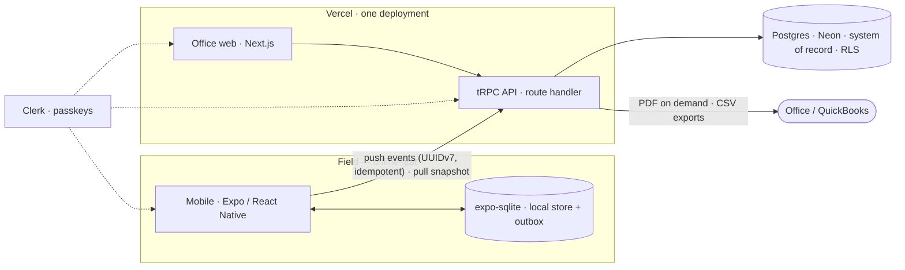

# TRADER — Architecture

What the system is and how it is built. What it does → [PRD.md](PRD.md). How code is written →
[RULES.md](RULES.md). Versions live in the `package.json` files and the lockfile, never here.

## System architecture

A modular monolith: one codebase, one API, one database, one deploy target. Clients never argue
with the server; they send append-only events and snap to server truth on the next sync.



| Piece          | Role                    | Notes                                                                                   |
| -------------- | ----------------------- | --------------------------------------------------------------------------------------- |
| `apps/mobile`  | Field client            | Owns the device store and outbox; works with no signal                                  |
| `apps/web`     | Office client, API host | Next.js serves the office UI and the tRPC route handler both clients call               |
| `packages/api` | The one API             | tRPC routers, request context, role gates, sync boundary; exports `AppRouter` as a type |
| `packages/db`  | Schema and migrations   | Drizzle schema, migrations, seed, invariant tests against a real database               |

## Technology stack

| Layer         | Choice                                                              | Why                                                                    |
| ------------- | ------------------------------------------------------------------- | ---------------------------------------------------------------------- |
| Mobile        | Expo (React Native), EAS builds                                     | One codebase for iOS and Android; managed builds                       |
| Local store   | Drizzle on `expo-sqlite`                                            | Same ORM as the server; storage only — the sync layer is ours          |
| Web + API     | Next.js on Vercel Pro, Node runtime, `iad1`                         | One deployment, one bill; `pg` Pool with `attachDatabasePool`          |
| API           | tRPC + zod + superjson                                              | End-to-end types; validation at every boundary; Dates survive the wire |
| ORM           | Drizzle                                                             | SQL-shaped, TypeScript-native, first-class migrations                  |
| Database      | PostgreSQL — Docker locally, Neon Launch (`aws-us-east-1`) deployed | Plain Postgres only; autoscale 0.25–1 CU, scale-to-zero on             |
| Auth          | Clerk Pro                                                           | Passkeys + email-code fallback; invitation-only; 30-day max session    |
| Observability | Sentry, PostHog                                                     | Errors and product analytics; PII scrubbed before the pilot            |
| Jobs          | Vercel Cron; GitHub Actions for backups                             | No queue to run                                                        |
| Backups       | Nightly encrypted `pg_dump` to Cloudflare R2; weekly restore-verify | Plus a timed restore drill before the pilot                            |
| Secrets       | Vercel env vars, EAS secrets, GitHub Actions secrets                | Each platform holds what it needs; nothing in the repository           |

Rejected: WatermelonDB and PowerSync (sync), SQLCipher (OS encryption plus data minimization
instead), SMS and passwords (auth), a separate backend host, AWS App Runner and ECS. Inngest,
Twilio and Cloudflare Images are adopted only if a task shows them cheaper than the alternative.

## Invariants

Enforced mechanically and tested against a real database. A failing invariant test means the
change is wrong, not the test.

1. `work_session_events` rejects UPDATE, DELETE and TRUNCATE for every role, including the
   application's own connection. Corrections are new events.
2. Event ids are client-generated UUIDv7 and are the idempotency key. The server never
   defaults one; the device never regenerates one on retry.
3. Money is integer minor units paired with a currency code. No floating point anywhere.
4. Every tenant-scoped table has `company_id NOT NULL`, composite foreign keys that carry it,
   and row-level security `ENABLE`d and `FORCE`d, keyed on `app.company_id`.
5. The application role is created in SQL with `NOBYPASSRLS` — never through the Neon console,
   CLI or API — and the server refuses to serve under a role that can bypass RLS: the check
   runs in every protected transaction, on the connection that transaction holds.
6. Tenant binding happens only through a server-side invitation; no request names a company.
7. Derived values — `work_date`, session state, worked duration — are computed from the event
   fold, never stored. Append-only tables carry no `updated_at`.
8. Schema changes are additive: no migration drops a table, a column or data. Relaxing a
   constraint, or withdrawing a privilege from the application role, is allowed when its
   decision row says why. A destructive migration is a defect.

## Sync protocol

- Capture touches local storage only: no network call and no session check on that path.
- Push: the outbox sends oldest-first in batches. The server takes each record in its own
  transaction, upserts by id, validates each event against the folded timeline with the event
  inserted at its effective instant (the check is two-sided: what came before and what comes
  after must both stay legal), and answers per record — `accepted`, `duplicate` (success), or
  `rejected` (permanent, never retried, surfaced as needing attention). Transport failure is not
  rejection; a record omitted from a response is retried.
- Pull: a per-user snapshot of own entries plus reference data. No cursor in V1.
- A cycle is push then pull. Triggers — reconnect, foreground, timer — coalesce so two cycles
  never run at once. A record stuck `syncing` is reclaimed after two minutes.
- Ordering: `client_timestamp`, then `server_timestamp`, then `id`. Device skew is measured per
  push as `|device_now − server_now|` with a 5-minute tolerance; a skewed event is still
  written, ordered by `server_timestamp`, flagged, and routed to approval.
- Versioning on two axes: `schema_version` per event, accepted forever through upcasters; a
  protocol version per request. The kill switch ships in build 1: `status.get`, public, answers
  `normal`, `read_only`, `paused` or `update_required`; no state stops capture or drops a record.
- Sync bookkeeping — state, attempts, next attempt — stays on the device and is never sent.
- Event time is judged by the server as well as asserted by the device (to be built, TASKS
  Stage 4): an event that claims it was captured online at the time it carries, yet differs
  from its receipt by more than the tolerance, is flagged `clock_skewed` and goes to approval;
  an event timed later than its receipt plus the tolerance is rejected `time_in_future`.
- `captured_offline` is true when the device's first delivery attempt for the record began
  more than two minutes after capture. The device records it; the server check above is what
  keeps a false "online" from skipping approval.
- A record the server did not accept leaves a trace (to be built, TASKS Stage 4): one
  minimized line through the error-reporting seam — request id, record id, kind, result code,
  user id, company id — and never the payload.
- The pull snapshot grows by optional fields within protocol 1, which clients ignore when they
  do not know them; a new protocol version is for a change in meaning. The snapshot is derived
  per request and carries no `schemaVersion`.

## Concurrency

One global lock order, so no two writers can wait on each other:

1. `jobs` rows, 2. `customers` rows, 3. `crews` rows, 4. `users` rows in id order (the caller
   re-read among them, `lockActiveSelf`), 5. `companies` row, 6. the company's field-write
   advisory lock (shared by every labor and material writer, exclusive for a closeout), 7. the
   worker's advisory lock, 8. `materials` rows, 9. the `approvals` row.

A holder of the field-write lock takes no row lock on the first five beyond foreign-key
`KEY SHARE`. Every stamp that must sort after a lock is read from the server's clock after
that lock (`core/clock.ts`), never from `now()`. The one known inversion is a first sign-in's
bind, which holds the caller's `users` row `FOR UPDATE`; Postgres aborts one side and the call
is retried.

## Runtime bounds

| Bound                         | Value                       | Where                              |
| ----------------------------- | --------------------------- | ---------------------------------- |
| Pool size per server instance | `DATABASE_POOL_MAX`, 10     | `packages/db/src/env.ts`           |
| Wait for a free connection    | 5 s                         | `packages/db/src/client.ts`        |
| Protected call                | lock 5 s, statement 20 s    | `packages/api/src/core/trpc.ts`    |
| Push record                   | lock 2 s, statement 4 s     | `packages/api/src/core/trpc.ts`    |
| Push batch                    | 100 records, none after 8 s | `packages/api/src/sync/push.ts`    |
| Calls per HTTP request        | 10                          | `apps/web/src/server/handler.ts`   |
| Client-asserted instant       | 1970-01-01 to 9999-12-31    | `packages/api/src/core/instant.ts` |

An idle pooled connection that the server drops is logged by class and SQLSTATE and discarded;
it never ends the process.

## Before the first deployment

None of these exists yet; each is a line in TASKS Stage 6 and a release gate in Stage 8.

- Production identity: the Clerk adapter behind the identity seam; the development adapter is
  not wired into a production build at all.
- The deployed login role is `trader_app` itself, verified on the deployed database: not a
  superuser, no `BYPASSRLS`.
- Rate limits per identity and per address in front of the API; a request body limit.
- An `Origin` check on state-changing requests, and session-cookie attributes decided with the
  identity provider.
- A content security policy and transport security, tested against the deployed app. The
  baseline headers (`nosniff`, frame denial, referrer policy) are already set for pages and the
  API in `apps/web/next.config.ts`.
- A server-enforced sync brake: the kill switch is advisory by design and cannot stop a client
  that ignores it.
- A readiness check that touches the database and the role; environment validated at start.
- Backups, a rehearsed restore, and a written migrate-and-rollback procedure.
- An error reporter that keeps the minimized event and sends nothing else.

## Domain and identifiers

`jpteq.app` is the only domain: the apex serves the web app and the association files, `www`
redirects to the apex, `api.` aliases it, `clerk.` is DNS-only, and the subdomain allowlist is
closed. Passkey rpID `jpteq.app` — irreversible once the first credential exists. Bundle ID and
package name `app.jpteq.trader`.

## Folder structure

The root holds `.github/workflows/ci.yml` (the one workflow; its job name is the required check),
`assets/brand/` (`logo.png`, `icon.png`; DESIGN, Brand), `apps/` and `packages/` (System architecture
table; `apps/mobile` planned), `docs/` (the six documents), `CLAUDE.md`, `LICENSE` and `README.md`.

```text
apps/web/src/app/        office screens, shared UI modules, strings, theme
apps/web/src/server/     the route handler, the pool, the identity seam
packages/api/src/core/   request plumbing: context, tRPC and the caller transaction, identity,
                         user resolution, error reporting, kill switch, locks, clock, instants
packages/api/src/<domain>/   approvals, closeout, crews, customers, jobs, labor, materials,
                         roster, sync, demo — pure cores and writers, one concern per file
packages/api/src/routers/    one thin router per namespace; `router.ts` composes them
packages/db/src/schema/  one Drizzle file per table group
packages/db/migrations/  the journal; hand-written SQL in `generate --custom` files
packages/*/test/         mirrors `src/` by folder; `helpers.ts` and `setup.ts` at its root
```

## Decisions

One line each; the date is when it was settled. A change is a new row naming the row it supersedes, never an edit to an old row.
Rows dated 2026-11-05 or earlier cite another as `row N`, meaning line N − 3 of this file at `779894f`; later rows cite one by date and subject.

<!-- prettier-ignore -->
| Date       | Decision                                                                                 | Supersedes                        |
| ---------- | ---------------------------------------------------------------------------------------- | --------------------------------- |
| 2026-07    | Modular monolith; the API runs inside the Next.js deployment on Vercel                   | Separate backend host             |
| 2026-07    | Build the sync layer; Drizzle on `expo-sqlite` for storage only                          | WatermelonDB                      |
| 2026-07    | Append-only labor log, client UUIDv7 ids, integer cents, derived values never stored     | —                                 |
| 2026-07    | Biometric attestation on clock actions, never blocking                                   | —                                 |
| 2026-10    | Snapshot pull, no cursor in V1                                                           | Keyset cursor (2026-07)           |
| 2026-10    | RLS from the first migration; app role created in SQL with `NOBYPASSRLS`                 | RLS deferred to the second tenant |
| 2026-10    | Payments out of V1; invoices `draft → issued → void`, credit memos, QuickBooks CSV       | Stripe in V1 (2026-07)            |
| 2026-10    | Passkeys with email-code fallback; no SMS, no passwords                                  | Phone-number recovery (2026-07)   |
| 2026-10    | Office-approval rule for offline, edited, user-timed and location-flagged entries        | —                                 |
| 2026-10    | Foreground location stamps at clock events only; geofenced clock-in dropped              | Advisory geofence spike (2026-07) |
| 2026-10    | Effective-dated pay rates; immutable closed pay periods; no pay calculation in V1        | Open                              |
| 2026-10    | `jpteq.app` everywhere; bundle ID `app.jpteq.trader`                                     | `jpteq.com`                       |
| 2026-10    | Production: Vercel Pro, Neon Launch, Clerk Pro; nightly `pg_dump` to R2, weekly verify   | Open hosting decision             |
| 2026-10    | Web approval by push, Expo push, Inngest and Resend deferred past V1                     | Phase 3–4 plans (2026-07)         |
| 2026-10-13 | Rebuild from `archive/pre-rebuild`; six-doc set replaces the previous documentation      | 2026-07 doc set and ADR register  |
| 2026-10-13 | Brand: D Sierra Painting mark; indigo accent `#2808AC`; red reserved for the mark        | Blue accent; no brand asset in V1 |
| 2026-10-27 | Compose vars or `DATABASE_URL` for `pg`; `drizzle-kit migrate`; `.env` via `loadEnvFile` | Archive env and migrate (2026-07) |
| 2026-10-28 | Ids: `uuidv7()` DB default on office rows; device UUIDv7, no default, on phone rows      | ORM `$defaultFn` ids (2026-07)    |
| 2026-10-28 | Enumerations are Postgres enum types in `enums.ts`; a value is only ever added           | —                                 |
| 2026-10-28 | `deactivated_at` timestamps on roster tables; no `active` flag, state is derived         | `active` boolean (2026-07)        |
| 2026-10-28 | `work_session_events` facts are typed columns: stamp, attestation, `clock_skewed` + `clock_skew_ms`; no `payload`, no `created_at` | `payload` jsonb (2026-07)         |
| 2026-10-28 | Skew verdict stored at write time under the tolerance then in force; the ledger's order never moves | —                                 |
| 2026-10-28 | Triggers and functions live in `generate --custom` migrations; a rejected mutation is SQLSTATE `23000` | Hand-journaled `0001` (2026-07)   |
| 2026-10-29 | `approvals`: one row per event, written at push when the rule fires; no row is approved by default; `reasons` enum array; a decision is set once | —                                 |
| 2026-10-29 | Pay periods: inclusive work-date ranges, overlap-free by exclusion; closed in order and frozen; an event's period is derived from `work_date` and `server_timestamp` against `closed_at` | —                                 |
| 2026-10-29 | `currency` beside every `_cents` column, no default; `_cents` is `integer` until a sum can exceed it | `char(3) default 'USD'`, bigint (2026-07) |
| 2026-10-29 | Extensions (`btree_gist`) and exclusion constraints live in `generate --custom` migrations; a rule naming an enum member lives in plpgsql | —                                 |
| 2026-11-03 | PRD approval triggers are five: offline capture, edit/correction, user-set time, missing/out-of-radius location, clock skew beyond tolerance; every `approval_reason` member maps to exactly one trigger | Four-trigger list (2026-10)       |
| 2026-11-03 | Invoice state derived from `issued_at`/`voided_at`, no status enum; born draft; `number` assigned at issue by trigger from a transactional per-company counter; issued rows frozen except one void | — |
| 2026-11-03 | Credit memos append-only, against an issued unvoided invoice, numbered from their own per-company series in the same counter row | — |
| 2026-11-03 | Materials carry the receipt total in cents, nullable with currency, priced later; photos attach to a job and optionally a material, same job by composite key; the row holds object metadata only | `photo_s3_key` on materials (2026-07) |
| 2026-11-03 | Cross-row equality (currency, customer-of-job, job-of-material) is enforced by composite foreign keys over an added unique, which makes the referenced column immutable while a child exists (invoice currency once lines exist, a job's customer once an invoice exists); triggers are used only for lifecycle, sequencing and existence rules | — |
| 2026-11-03 | Object store: Cloudflare R2 bucket `trader-media` in the same account as the backups; presigned uploads through the API; holds material/job-progress photos and each company's logo. `photos.object_key` is the bucket key, provider-neutral text assigned by the server at push from company_id and id. No store client in Stage 2 | — |
| 2026-11-03 | `audit_log` is append-only by 0002's guard, written by API code in the same transaction as the write it records, never by a capture trigger; `action` is `entity_table.verb` text under a prefix check, not an enum; written by after-V1 wiring, empty in V1 | — |
| 2026-11-03 | `before`/`after` jsonb snapshots of the audited row; the typed-column rule of row 147 governs domain facts, and the audit log holds none of its own | — |
| 2026-11-03 | Tenancy: `public.app_company_id()` maps unset and `''` to NULL and is the only reader of `app.company_id`; every tenant table has a `<table>_tenant` policy, `FOR ALL TO trader_app`, USING equal to WITH CHECK; `companies` matches on `id`; an unset tenant reads zero rows | — |
| 2026-11-03 | Runtime role `trader_app`, `LOGIN NOINHERIT NOBYPASSRLS`, created if absent in a custom migration, no password in the repository; privileges are per-table grants stated by the migration adding the table, no default privileges, no TRUNCATE; append-only tables get SELECT and INSERT | — |
| 2026-11-03 | Startup guard `assertRuntimeRole` refuses a superuser or BYPASSRLS role, or a tenant table without ENABLE and FORCE, in one query before the first tenant query | — |
| 2026-11-03 | Migrator and tests run as the owner; RLS tests take the app role by `SET LOCAL ROLE` in a rolled-back transaction; the tenant is set by `set_config(…, true)` per transaction | — |
| 2026-11-03 | Seed: owner-only (refuses a role without `rolsuper` or `rolbypassrls`) on the migrate env contract, one transaction, raw SQL; one company by fixed id, its counter inserted once at 1/1, the admin upserted on `(company_id, lower(email))` with `identity_subject` NULL; a development and CI fixture with placeholder values, run by `pnpm db:seed` locally and proven by tests, not a CI step; the pilot's own company and counter are not seeded by it | Archive seed (2026-07) |
| 2026-11-04 | Location beyond clock-event stamps only as OS geofences on assigned jobs' existing coordinates and radius, inside the employee's authorized work window, for local reminders; entries and exits stay on the device; clock-event stamps stay foreground (PRD, Smart Clock-In) | Foreground-only location (2026-10) |
| 2026-11-04 | Smart Clock-In after the manual pilot: arrival raises a local notification, the employee confirms a normal clock event; departure only reminds; no automatic event, no new approval reason, no push; no location subsystem | Geofenced clock-in dropped (2026-10) |
| 2026-11-04 | Identity binding: `users_identity_select` and `users_identity_bind` policies for `trader_app`, keyed on server-set `app.identity_subject`/`app.identity_email` read through `app_identity_subject()`/`app_identity_email()`; first sign-in binds the invited row, nothing is inserted; anything but exactly one invitation fails closed; no SECURITY DEFINER. `users_identity_guard`, every role, 23000: `identity_subject` changes only NULL → the verified subject with the tenant unset and every other column but `updated_at` unchanged (whole-row compare); under an identity setting the bind is the only update; unbinding is a future decision | JIT provisioning into the oldest company (2026-07) |
| 2026-11-04 | One transaction per protected procedure call, not per HTTP request: settings cleared, `assertRuntimeRole` on every transaction (no cache), identity set, user resolved or bound, identity cleared, tenant set, procedure run; a `{ ok: false }` result is rethrown so nothing commits, a first-sign-in bind included; the procedure's context has `tx` and `user`, the pool removed by value | — |
| 2026-11-04 | Identity adapter: `identify(headers)` returns `{ subject, email, emailVerified: true }` or null, zod-parsed again at context creation; the development adapter reads two headers, off unless `TRADER_DEV_IDENTITY=enabled`, and refuses the request under any `NODE_ENV` but `development` or `test` | Archive `DEV_AUTH_ENABLED` (2026-07) |
| 2026-11-04 | Every resolution failure — no identity, no or ambiguous invitation, deactivated, lost bind race, the bind's `users_identity_subject_unique` conflict — is one `UNAUTHORIZED` with one message; any other error is `INTERNAL_SERVER_ERROR` with a generic message and no stack | — |
| 2026-11-04 | A deactivated account resolves to no user; a deactivated invitation is never bound (`deactivated_at IS NULL` in the bind and on its returned row); deactivated invitations still count toward "exactly one" | — |
| 2026-11-04 | Fail-closed codes (RULES): a switched-off route answers 404; an API call answers `UNAUTHORIZED` (401) without an active user and `FORBIDDEN` (403) when its role is not admitted | "deny and 404" read as covering every guard |
| 2026-11-04 | Role gates: `roleProcedure(...roles)` chained on the protected procedure, a per-procedure allowlist over the role resolved in its transaction; no hierarchy, so a role added to the enum is admitted nowhere until named; nothing a client sends is read | — |
| 2026-11-04 | Gate order and answers: resolution first, so an anonymous or deactivated caller is `UNAUTHORIZED` at every gate and never learns the role wanted; an active caller without the role is `FORBIDDEN` with one message naming no role; a denial rolls back like any failed call | — |
| 2026-11-04 | Role gates are procedure-entry checks only. Worker job assignment, foreman crew and job scope, and every other resource-level permission are enforced independently inside each business procedure that needs them, in that procedure's own task; RLS stays company-wide and a gate never narrows or widens it | — |
| 2026-11-04 | Labor fold: one effective instant per event — `server_timestamp` when `clock_skewed`, else `client_timestamp` — for ordering, intervals and `work_date`; durations are elapsed UTC milliseconds | — |
| 2026-11-04 | A session's `work_date` is its effective start's date in `companies.timezone`; a session crossing midnight belongs wholly to it, and so do its pay period and payroll line | — |
| 2026-11-04 | Voids are accounting-only: zero hours, span kept, an open voided session still needs `ended`; one void per session, naming a root `started`; no un-void | Positional `voided` (archive LOGIC SESSION-2) |
| 2026-11-04 | A correction names a root event, keeps its worker and type, keeps its job unless it corrects a `started`, and stays in its session; the latest accepted (`server_timestamp`, then `id`) wins, and a candidate that would not win is rejected | — |
| 2026-11-04 | A session's job is its effective `started`'s; a new ordinary pause, resume or end must match it; every other event's `job_id` is provenance, never re-judged | — |
| 2026-11-04 | Validation replays the worker's whole timeline with the candidate in place; one writer per worker: READ COMMITTED, `pg_advisory_xact_lock`, read, validate, insert; a stored ledger that fails replay is an internal error, never a rejection | Next-event-only check (archive) |
| 2026-11-04 | Pushed `server_timestamp` is written explicitly: `receivedAt`, read after the worker lock, at least that worker's newest stamp + 1 ms, one value per worker per batch | `now()` on pushed events (column comment, 2026-10-28) |
| 2026-11-04 | Two sources for one worker out of order: an event whose predecessor has not arrived is rejected; the office repairs once the predecessor lands | Archive "a `resumed` before its `paused` is legal" |
| 2026-11-04 | A repair needing two events at once (a session before a later one, a pause before a later pause) is an office-only atomic repair set, its own TASKS line; never a sync record | — |
| 2026-11-04 | Day closeout: `day_closeouts`, append-only like the ledger; device UUIDv7 id; one per `(company_id, job_id, work_date)`, the date the foreman's business key, not derived; it stores the zone it was judged in and whether it wrote `jobs.status` (not if archived or a later-dated closeout exists); no hours stored | — |
| 2026-11-04 | Closeout membership is sealed: the closeout declares its worker and material counts, and deferred constraint triggers check at commit that the append-only membership numbers exactly that and the closeout is visible; callers fire them early with `SET CONSTRAINTS … IMMEDIATE` | — |
| 2026-11-04 | Each worker with a session on the day gets a mark, `ledger_through`, their ledger's newest receipt stamp; their events stamped at or before it, folded in the stored zone, are the day as submitted; a change to fold semantics must say how existing closeouts are read | — |
| 2026-11-04 | A closed-out material is frozen by trigger (whole row, DELETE included) except `cost_cents`/`currency`; its later change is a correcting entry, a scheduled task | — |
| 2026-11-04 | Company field-write lock: every labor and material writer takes it shared (labor before the worker lock), the closeout takes it exclusive, keyed on the tenant and refusing without one. Lock order: jobs, crews, users, companies rows, then the field-write lock, then worker locks, then materials rows; a holder of the field-write lock takes no row lock on the first four beyond foreign-key `KEY SHARE` | Row 184's per-worker-only locking |
| 2026-11-04 | `closeout.submit` answers `accepted`/`duplicate` with an acknowledgement of id, server stamp and status result only, or `rejected` with `id_conflict`, `already_submitted`, `sessions_open`, `work_date_in_future`; the caller's own id is answered first, before role or scope | — |
| 2026-11-04 | Closeout scope: the job's current crew's foreman, crew active; the role is checked in the procedure after the own-id answer, and job, crew, caller and company are re-read under row locks held to commit; one `FORBIDDEN` for every refusal | Row 176's gate placement, for this procedure |
| 2026-11-04 | A closeout records server state at submission, not a verified review; the review read and its fingerprint are a Stage 3 task that must land before the field closeout ships | — |
| 2026-11-04 | `closeout.review`: the foreman gate, then row 195's scope with the job, crew, caller and company rows `FOR SHARE` and no field-write lock, so it may combine committed states from different moments; workers with a session on the day only; materials without cost; no approval state; an existing closeout is flagged, the content stays live | — |
| 2026-11-04 | Review fingerprint `v1.`: SHA-256 of positional tuples — tenant, job, date, zone, job status, each session's sources, times, state, void and hours, each material's facts but cost — recomputed, never stored. Required at submit and compared under the closeout's locks after `sessions_open`, never on a retry (`same()` ignores it); a mismatch is `rejected` `review_stale`, and a new confirmation is a new id. A concurrency precondition, not proof of review | Row 194's codes; row 196 |
| 2026-11-04 | Material corrections: `material_corrections`, append-only, device UUIDv7, naming a sealed member by composite foreign key to `day_closeout_materials`, so only a closed-out material is corrected and the day as submitted is the receipt as logged, never written; `amend` replaces description, quantity and unit together, `void` is final; never job, `logged_at`, buyer or cost; always the receipt, never another correction. A correction counts once approved: the receipt with its approved corrections in (`server_timestamp`, `id`) order, derived, never stored. `approvals` takes exactly one subject, `event_id` or `material_correction_id`; a correction's row is written pending with `corrected`, NULL-safe and with no NULL reason, never decided by its submitter (trigger); every row's subject and reasons are fixed | Row 150's one row per event |
| 2026-11-04 | `material.correct`: admin, or the job's current crew's foreman; own id first; scope row locks, the field-write lock shared, the material `FOR NO KEY UPDATE`; `accepted`/`duplicate`, or `rejected` `id_conflict`, `not_in_closeout` (permanent for that sealed closeout, its date in the closeout's stored zone; never retried automatically, the correction kept recoverable on the device), `closeout_pending`, `correction_pending` (one pending per material), `material_voided`, `no_change`; a rejection writes nothing, so the same id may be sent again; unavailable or out of scope is one `FORBIDDEN`. Push: each in its own transaction, held until its closeout's result, at most one automatic re-attempt, else needs attention; a decision takes the same locks | — |
| 2026-11-05 | Approval triggers are six: row 154's five plus arrival after the day's accepted closeout, `after_closeout`, judged on the session's effective start (labor) or `logged_at` (a receipt) in each closeout's stored zone, under the shared field-write lock; the closeout, its marks and fingerprint never change; how a pending event's session counts is the approval queue's | Row 154 |
| 2026-11-05 | `offline` is capture evidence: `captured_offline`, recorded by the device at capture (no confirmed API reachability; unknown counts as offline), on events and receipts; delivery delay is evidence, never a reason; receipts also store `clock_skewed` and `clock_skew_ms`; deferred triggers require an approval row holding every reason those columns imply | `enums.ts` "receipt lag" reading |
| 2026-11-05 | Original receipts are approval subjects: `approvals.material_id`, the third of exactly one subject, written at push, born pending, never decided by the logger; reasons `offline`, `clock_skewed`, `after_closeout`. An after-closeout receipt is corrected like a member: corrections reference `materials`, a trigger requires membership or that approval, and its facts freeze as 0018 freezes a member's | Row 199's two subjects and member-only key |
| 2026-11-05 | `sync.push`: one caller transaction per record, each running row 171's sequence (role and deactivation re-read; authority from rows locked in it), in batch order; ≤ 100 records, none started after 8 s, `lock_timeout` 2 s, `statement_timeout` 4 s; a thrown record stops the batch, it and the rest omitted; FORBIDDEN answers `rejected` `not_permitted`; UNAUTHORIZED after a completed record returns the results so far; kinds `labor_event`, `material`, and `closeout` and `material_correction` delegated unchanged; each record its own receipt stamp. `sync.push` amended: each record transaction's lock and statement timeouts are set by its first statement, before identity resolution, so a first sign-in's bind is bounded too; a push in which no record ran still resolves its caller, in a transaction with no record, so nothing is answered to an anonymous, uninvited or deactivated caller; a receipt's `created_at` is read after its locks | Row 171 for this procedure; row 185's one value per batch; Row 204's timeouts inside the record; its unresolved answer when nothing ran |
| 2026-11-05 | Push authority: own labor for any role; a foreman's also for current members of an active crew they lead, on its jobs; a `started` or a receipt needs a non-archived job of a crew the caller is in or leads (an admin: any); pause, resume and end only their session's job; no device corrections or voids. Order: jobs, crews, `crew_members` read unlocked (no UPDATE grant), users in id order, companies, field-write lock, worker lock. An id held by an invisible row is `id_conflict` | Row 193's order, extended |
| 2026-11-05 | `sync.pull`: own sessions with a `work_date` in the last 14 days and any open one, their events with approval state, own receipts as logged and as in effect; the jobs push admits; led crews' active members by id and name; no coordinates, cost, contact or rate. Requests carry `protocolVersion` 1; each record its `schemaVersion`, upcast to v1, an unknown one omitted | — |
| 2026-11-05 | Crew membership writers (Stage 4) lock the crew row `FOR NO KEY UPDATE` before adding or removing a member, so a removal waits for any push holding that row `FOR SHARE` and never commits under a push that relied on it; push keeps reading `crew_members` without a lock; the race is that writer's task's test | Row 205's unlocked read alone |
| 2026-11-05 | Approval accounting: every accepted event stays in the fold, so validation, winners, open sessions, `work_date` and closeouts never read a decision. A session counts by its in-effect sources (`replay` winners) and its void, no approvals row meaning approved: an approved void is `voided`, 0; else a rejected source `rejected`, 0 until a later correction wins; else a pending source or void `pending`, withheld; else `eligible`, its nonvoided worked ms (a rejected void is disregarded, the hours taken from the replay without it). A superseded correction's decision is moot; eligible is not export-ready (an open session stays open). A receipt counts once approved or row-less, an approved void taking it out; its corrections change its facts, never its eligibility | Row 201's open clause |
| 2026-11-05 | `approval.queue` and `approval.decide`, admin-gated. Queue: pending only, `(created_at, id)` order, the cursor the last approval's id; every subject with its stored reasons, `ownEntry`, a labor item's `effect` and live session; no coordinates, cost or rates. Decide: the approval read unlocked (its subject is fixed), the caller `FOR SHARE`, a correction's field-write lock shared and material row as `material.correct`, then the approval row `FOR NO KEY UPDATE`, last in the lock order; `decided`, `duplicate` (same decision, same admin), `rejected` `already_decided` with the standing decision, or `own_entry`; a missing or foreign id is the gate's FORBIDDEN; `decided_at` is the server clock after the locks; never reversed. Nobody decides their own entry — a labor event's worker (never merely its initiator), a receipt's logger, a correction's submitter — refused in the API and in SQL (0020, 0022, 0025, which also writes event approvals pending) | Row 193's order, extended; `approvals.ts`'s API-only event rule |
| 2026-11-05 | Office labor repairs: `labor.repair`, admin-gated then `lockActiveSelf`; one worker's set of 1–20 `append`, `correct` and `void` operations with device UUIDv7 ids, validated as one timeline (`validateEvents`; the single-event check is its one-element case) and written all or nothing in one savepoint. Office events are user-timed, not offline, unskewed, attestation `none`, unstamped, initiated by the caller; a void sits at its receipt on its root's job. Any visible job or worker, archived or deactivated included; a missing one is one FORBIDDEN. Reasons by the push rule plus `corrected` for corrections and voids, `after_closeout` judged on the repaired session (row 201); each approval pending in the same transaction, 0026 requiring `corrected` at commit. A correction identical to its source is accepted; a correction names the source it replaces, `repair_stale` if another won, never compared on a retry. `accepted`/`duplicate` with acknowledgements in input order, or `rejected`: a fold or validation code, `id_conflict` (an invisible holder included), `time_in_future`. Lock order: caller row, field-write lock shared, worker lock; no approval lock; validity never reads a decision | — |
| 2026-11-05 | Kill switch: `status.get` on the public procedure, no identity, no database query, no tenant; input protocol version, platform (`ios`, `android`) and native build (a positive integer increasing per platform); answers `{ version: 1, state }`, the most restrictive of `TRADER_SYNC_MODE` (`normal`; `read_only`, pull only; `paused`, no sync), `update_required` below the platform's minimum build or the lowest protocol, and `paused` above the highest; invalid configuration is `paused`, reported once per instance. Advisory to cooperative clients: push and pull do not read it, so it cannot stop a client that ignores it. A client syncs only on a fresh well-formed answer in that cycle; capture never stops, held records stay pending, no state rejects, clears or fails a record. Configuration is deployment environment, changed by a new deployment | "States named when it is built" (Sync protocol) |
| 2026-11-05 | Error reporting: `ErrorReporter.report(event)` with a minimized event (source, path, type, error names, SQLSTATE), never a stack, message, input, context, identity, tenant or location; reported are what answers `INTERNAL_SERVER_ERROR`, a push record's failure after an earlier record committed, and invalid kill-switch configuration; never an expected 401, 403, 400 or record rejection. Built, minimized and sent inside one guard, never awaited, its failure swallowed; after the call settles, or for push after that record's transaction rolled back while the request continues. Required in the request context; a stderr log reporter until Sentry (Stage 6) implements the interface | — |
| 2026-11-06 | Dated worker-job assignments (to be built, Stage 4): a worker, a job and a date with an expected start and end; planning only — never read by push authority, validation, the fold, `work_date`, approvals, closeouts, pay or invoices; authority stays crew membership judged at receipt (2026-11-05 push authority), and a worker may work several crews' jobs in a day. 'Worker job assignment' in the 2026-11-04 role-gate row, and 'assigned jobs' in the 2026-11-04 geofence and Smart Clock-In rows, mean jobs of the worker's crews, not dated assignments; PRD now says 'crew job'. Writers, membership at assignment time, zone and DST rules, and any relation to the arrival-reminder work window are decided in the consuming task | PRD Goals non-goal 'scheduling' (2026-10-13 six-doc set), for dated worker-job assignments only |
| 2026-11-06 | Admin day closeout (to be built, Stage 4): `closeout.review` and `closeout.submit` will also admit an admin, with the input, answers, own-id-first retry, `v1.` fingerprint, field-write lock and lock order unchanged and the foreman path behaving exactly as today; an admin's scope re-reads the job, the caller and the company under the same row locks, and `jobs.status` is written as today; archived and crew-less jobs are that task's decision | 2026-11-04 closeout scope and `closeout.review` foreman gate, for an admin only |
| 2026-11-06 | Own profile (to be built, Stage 4): an active user changes their own `name` and `phone` through one procedure that writes only those two columns of the caller's resolved row; `phone` is contact data, never identity, recovery or authorization; `email`, `role`, `company_id`, `identity_subject` and `deactivated_at` are never self-written; an email changes through the identity provider's verified flow, and how `users.email` follows it is decided with worker sign-in | PRD After V1 'roster self-service', for own name and phone |
| 2026-11-06 | Smart Clock-In in the pilot is an optional job suggestion (to be built, Stage 5): on app open, one foreground location reading, used only on the phone and never sent, is compared with the locations of the jobs the last pull named as ones the worker may start on, today's assignment first; a match only pre-selects a job, and the worker's confirmation records a normal clock event with its own foreground stamp under the approval rule. No suggestion — manual selection — without permission, without a reading, with an uncertain reading, without coordinates, with several matches or with a stale snapshot. A suggestion never authorizes: push re-judges membership at receipt (2026-11-05 push authority). Job locations will reach the phone by an extension of `sync.pull` planned in that Stage 5 task; today's `pullOutput` is a strict protocol-1 schema, so that plan decides between optional protocol-1 fields and a new protocol version and proves it with compatibility tests against the shipped client; Stage 3's criterion is unchanged | 2026-11-04 'Smart Clock-In after the manual pilot', for the pilot suggestion only (arrival reminders unchanged); 2026-11-05 `sync.pull` 'no coordinates', for jobs the caller may start on, from that task |
| 2026-11-06 | Pilot scope (PRD, Pilot and V1 completion): sign-in; clock in/out and job switch with the job suggestion, no automatic clock-in; materials and photos; offline sync; dated assignments; approvals; foreman and admin closeout; pay periods and the payroll export; invoices created, issued and exported in TRADER with no discount feature; the office web responsive on phone and desktop. Arrival reminders follow the pilot; every other V1 feature, the full data export included, stays required for V1 complete; the pilot stays unpaid and V1 complete the billing trigger. Invoicing moves before the pilot (TASKS Stages 7 and 8 swapped) | Pilot build (PRD, 2026-10); 1280 pt desktop-only office web (DESIGN) |
| 2026-11-06 | Web host: `apps/web` serves the API at `/api/trpc` from one route handler on the Node runtime (`runtime = "nodejs"`, `dynamic = "force-dynamic"`), GET and POST; the context is built per request from the identity adapter, `onError` is `reportingOnError(logReporter)`, every API response is `cache-control: no-store`; one `pg` Pool per server instance from the db seam, created on the first request, never at module load, its sessions started as `trader_app` by startup parameter under `development` and `test` (production logs in as `trader_app`); the root `.env` is loaded by `next.config.ts` through `loadEnvFile`, tolerant of its absence | — |
| 2026-11-06 | Development sign-in in the browser: `POST /dev-signin` takes one field, the email, and sets one HttpOnly SameSite=Lax cookie, `trader-dev-email`; `apps/web` derives the subject, `dev:` + the email lowercased, and sets the two development headers before the api adapter sees the request, so the adapter and its gates are unchanged and a second sign-in rebinds nothing; the route answers 404 unless `devIdentityEnabled`, never 403; a sign-out clears the cookie; a built app honours none of it | 2026-11-04 identity adapter, for the browser transport only |
| 2026-11-06 | Office shell: DESIGN tokens are CSS custom properties in `apps/web/src/app/theme.css`, the web's theme module; server components with CSS Modules, no UI or styling dependency; the header mark is `assets/brand/logo.png` by static import and `/favicon.ico` is served from that same file by a route handler (`outputFileTracingIncludes`), one home for the asset; breakpoints and navigation wait for the first office screen | DESIGN "theme module per app", made concrete for the web |
| 2026-11-07 | Roster API (Stage 4 line 2): `roster.list`, `invite`, `setRole`, `deactivate`, `reactivate`, `setPayRate`, `payRates`, admin-gated; `me.update` writes the caller's `name` and `phone` only (2026-11-06 own profile). An invitation is a users row with email, name and role (`worker` unless named), `identity_subject` NULL, no mail until Clerk (Stage 6); a second email per company by `lower(email)` answers `rejected` `email_taken` through `ON CONFLICT … DO NOTHING`, never a caught 23505. Role and deactivation writers lock the caller, the target and every active admin of the company in one statement, `FOR NO KEY UPDATE` in id order (2026-11-04 lock order; no field-write lock, no other table; they read and write `users` only — a crew led by a demoted or deactivated foreman is the crew-membership task's), and re-judge from those rows: a deactivated caller UNAUTHORIZED, a demoted one FORBIDDEN, a missing or foreign target FORBIDDEN; demoting or deactivating the last active admin is `rejected` `last_admin`, judged under those locks so two admins racing leave one; an admin may change themself while another remains. A deactivated user keeps its bound `identity_subject`; `reactivate` clears `deactivated_at` and nothing else. Pay rates are insert-only: one row per `(user, effective_from)`, a second `rejected` `rate_exists`, no UPDATE path; the rate in force is the greatest `effective_from` ≤ today in `companies.timezone`; a rate inside a closed period is the pay-period task's rule | — |
| 2026-11-07 | Office web client: `@trpc/client` and `@trpc/tanstack-react-query` pinned to the installed `@trpc/server` (their peers are exact), `@tanstack/react-query`, `superjson` as the server's transformer; `createTRPCContext<AppRouter>` (type import) in `apps/web/src/app/trpc.ts`, one `QueryClient` per browser, `retry: false`, `httpBatchLink` to `/api/trpc` carrying the cookie, so the office calls the route handler as the phone does and no server-side caller exists; a mutation refreshes its screen by invalidating the list query; UNAUTHORIZED and FORBIDDEN render an empty state, any other failure the attention banner. One breakpoint, 768 px: at or above it the 1280 grid, the left navigation and the data table; below it one column, the navigation behind a menu button (`aria-expanded`), table rows stacked (DESIGN, Layout). A screen is a dynamic server page rendering one client component; office strings stay in `strings.ts` | 2026-11-06 office shell, "breakpoints and navigation wait for the first office screen" |
| 2026-11-07 | Customers, jobs and crews API (Stage 4 line 3), admin-gated: `customer.list`/`create`/`update`/`deactivate`/`reactivate`; `crew.list`/`create`/`update`/`setForeman`/`addMember`/`removeMember`/`deactivate`/`reactivate`; `job.list`/`create`/`update`/`assign`/`setStatus`. Every writer locks its rows in the global order — the job `FOR NO KEY UPDATE` (`FOR UPDATE` in `job.update`: a customer change must exclude an invoice's `KEY SHARE`), then the customer `FOR SHARE` (customers rows sit between jobs and crews in the 2026-11-04 lock order, extended), then the crew (`FOR NO KEY UPDATE` for a crew or membership write, `FOR SHARE` for a job naming it), then users rows `FOR SHARE` in id order with the caller re-read among them — so a push holding the job or crew `FOR SHARE` finishes before the write commits and a later push reads the new state (2026-11-05 crew membership writers, fulfilled); no field-write lock, no ledger read. A crew's foreman is an active user with the `foreman` role and a member row, enforced at `create` and `setForeman` (which adds the member), derived afterwards as `foreman.available`; removing the foreman is `rejected` `is_foreman`. A missing or foreign id is the gate's FORBIDDEN; refusals are `rejected` — `user_inactive`, `not_a_foreman`, `crew_inactive` (a job naming a deactivated crew, a foreman change or a member added on one), `customer_inactive`, `jobs_assigned` (deactivating a crew with a non-archived job), `jobs_unarchived` (a customer with one), `has_invoices` (changing an invoiced job's customer), `is_foreman` — and a no-op is `unchanged`. `job.setStatus` writes any of the three statuses, `archived` reversible, reading no ledger; leaving `archived` re-judges the customer and crew under `FOR SHARE` (`customer_inactive`, `crew_inactive`), so a deactivated crew or customer never regains a live job; an open session on an archived or reassigned job ends through push as today. Names have no natural key; blank optional text is NULL; nothing is deleted but a membership row | 2026-11-04 role gates, resource checks for these procedures; 2026-11-04 lock order, extended with customers rows |
| 2026-11-07 | Crew membership lifecycle: membership is current-state — one row per (crew, user), added or removed, never dated — and authority stays judged at receipt (2026-11-05 push authority; 2026-11-06 dated assignments). A worker in several crews is ordinary, so a transfer is `addMember` to the new crew then `removeMember` from the old; a foreman change points the crew at an active foreman-role user and adds them as a member, the old foreman staying one until removed; neither reads or moves labor: events belong to a worker and a job, a closeout covers every worker with a session on it, and the fold never reads membership. Roster writers stay users-only (2026-11-07 roster API): a crew whose foreman is deactivated or demoted keeps its pointer, is shown as needing a foreman, and refuses crew labor and closeouts as the push and closeout rules already do; `sync.pull` is amended so led crews require the caller's `foreman` role, output unchanged. A deactivated member keeps its rows (reactivation restores them); a crew deactivates only with no non-archived job, a customer only with none, and un-archiving re-judges both; a deactivated crew is renamed and loses members but takes no foreman change or new member. Offline backlogs: a record captured under membership gone at push stays `rejected` `not_permitted` — permanent, shown as needing attention — and the office re-enters labor through `labor.repair`; office receipt entry is a later task; no effective-dated membership, no grace window | 2026-11-05 `sync.pull`, for led crews; 2026-11-07 roster API's "crew led by a demoted or deactivated foreman" |
| 2026-11-08 | Demo fixture (Stage 4 line 4): `pnpm demo` writes a synthetic company into a database of its own on the compose server — `trader_demo` or `trader_demo_<suffix>`, refused when `DATABASE_URL` is set, when the name is the configured database or when it already exists (`--reset` drops only such a name); the owner creates, migrates and bootstraps it through `seed(tx, company)` (the seed's three statements, now parameterised) and writes nothing else; every other row is a server-side caller on an app-role pool, one per persona bound as `dev:<email>`; UUIDv7 ids from a seeded generator and an anchor Monday, so a run is repeatable; one transaction per call rules out atomicity, so a failed step keeps the database for inspection (dropped only when nothing committed); clock skew is not simulated | 2026-11-03 seed, for a second bootstrapped company; 2026-11-07 office web client's "no server-side caller exists", for the demo script |
| 2026-11-08 | Figma is the design exploration and review surface (DESIGN, Design tooling): one file on the owner's team — tokens generated from the web theme module, populated screens as built, dated explorations; DESIGN.md stays the single authority and code never follows a frame it does not yet reflect; a UX review of the populated office screens, driven in the browser against the demo fixture, precedes Stage 4 line 5 and ships no screen change itself | DESIGN "theme module per app" (2026-10-13 six-doc set), for tooling only |
| 2026-11-09 | Office UX review (DESIGN: Layout, UI components, Brand), measured in the browser against the demo fixture at 390, 768 and 1280: the office header is 56 pt with `icon.png`, the signed-in name and sign-out (the development route's form until Clerk); navigation is grouped by workflow and `/` redirects to the first destination; a list screen is a page header with one primary action, then the list, its create form opened on demand; narrow table rows are two lines, and a table takes them by its own column's width (a container query at 720 px on the content column), not the viewport's; row editors are sectioned; result notes are announced and only a refusal is `attention`; record states are words, exceptions pills; shared modules in `apps/web/src/app`, no UI dependency, no API change | 2026-11-06 office shell's `logo.png` header mark (the favicon keeps it); 2026-11-07 office web client's narrow rows stacked cell by cell; DESIGN primary button (2026-10-13 six-doc set), for the wide office only |
| 2026-11-11 | V1 readiness revision: after a full read-only audit at `fbf2e5d`, the owner authorized one revision of PRD, ARCHITECTURE, DESIGN and RULES and of the repository's structure; the rows dated 2026-11-11 are its decisions, proposed by the audit and approved by the owner. Sections Concurrency, Runtime bounds and Before the first deployment are new homes for facts that lived only in rows | RULES 'never edit PRD, ARCHITECTURE or DESIGN to match code', for this revision only |
| 2026-11-11 | Document line caps removed from RULES and CI; a document states each fact once and is as long as that needs; the decisions table stays append-only | RULES caps (2026-10-13 six-doc set) |
| 2026-11-11 | Event-time plausibility (to be built): the server compares `client_timestamp` with its receipt. Not offline, not user-timed, yet more than the 5-minute tolerance from receipt: stored `clock_skewed`, reason `clock_skewed`, ordered by `server_timestamp`. Later than receipt plus the tolerance: `rejected` `time_in_future`, as `labor.repair` answers. No new approval reason | 2026-11-05 `offline` as device-recorded evidence alone; the per-push `device_now` reading as the only skew test |
| 2026-11-11 | `captured_offline` defined: the device's first delivery attempt for the record began more than two minutes after capture | 2026-11-05 'no confirmed API reachability; unknown counts as offline' |
| 2026-11-11 | Rejected-record trace (to be built): every push record answered `rejected`, and every record omitted after a failure, writes one minimized line through the reporter seam — request id, record id, kind, code, user id, company id; no payload, no location, no time. A request id is generated per HTTP request | 2026-11-05 error reporting 'never … a record rejection', for this one line |
| 2026-11-11 | `sync.pull` is extended by optional protocol-1 fields; clients parse it loosely and ignore unknown fields; the server's output schema stays strict. Protocol 2 is for a change in meaning. The snapshot carries no `schemaVersion` | 2026-11-06 pilot job suggestion's open choice; 2026-11-05 `sync.pull` 'each record its `schemaVersion`, upcast to v1' |
| 2026-11-11 | Pay-period membership (to be built): approved hours belong to the period containing their `work_date` when approved before that period closes; hours approved, corrected or repaired after it closes are exported once, as late-entry adjustments in the next period to close, carrying the original work date. A period is inserted open and never earlier than a closed one, enforced by an INSERT trigger | 2026-10-29 pay periods 'derived from `work_date` and `server_timestamp` against `closed_at`', made precise |
| 2026-11-11 | Hours rounding (to be built): durations are summed in milliseconds per worker, job and work date; that daily total is rounded half-up to 0.01 h; payroll and invoice lines are computed from the rounded figure in integer cents. No quarter-hour rounding | — |
| 2026-11-11 | Credit memos (to be built, Stage 7): the sum of an invoice's memos never exceeds its total; an invoice with a memo cannot be voided; issuing compares the frozen columns and cannot be combined with a void in one statement | 2026-11-06 open 'credit ceiling and void' |
| 2026-11-11 | An admin may approve a repair they wrote (unchanged; one-admin companies exist). The repair and its decision are both written to `audit_log` (to be built) | — |
| 2026-11-11 | `audit_log` is written in V1 for role, activation, invitation and pay-rate writes and for labor repairs and approval decisions: actor, time, before and after, in the write's transaction (to be built, Stage 4) | 2026-11-03 `audit_log` 'written by after-V1 wiring, empty in V1' |
| 2026-11-11 | Runtime bounds (section above): pool size from `DATABASE_POOL_MAX`, a 5 s wait for a connection, an `error` listener on the pool; every protected call sets `lock_timeout` 5 s and `statement_timeout` 20 s in its first statements, push keeps 2 s and 4 s; a request context may carry `waits: "inherit"` so a caller already inside a transaction keeps that transaction's settings (the test suites); at most 10 calls per HTTP request, the web client batching to the same number; client-asserted instants bounded to what Postgres can store, so an impossible date is `invalid_record`, not a record retried for ever | 2026-11-05 `sync.push` timeouts 'when the caller asks for them' |
| 2026-11-11 | Tests and the seed refuse to run while `DATABASE_URL` is set (`assertLocalDatabase`); the migrator does not. The seed stays a development and CI fixture | — |
| 2026-11-11 | `0027`: `trader_app` loses UPDATE on `pay_rates`, which are insert-only; a privilege withdrawn from the application role is not a destructive change (invariant 8, restated). `0019`, `0021` and `0023` relaxed constraints under the same reading | 2026-11-03 runtime role grants, for `pay_rates` |
| 2026-11-11 | Repository structure: `packages/api/src/core/` holds request plumbing; tests mirror `src/` by folder; the caller lock, the server clock and the closed-day query each have one home (`core/locks.ts`, `core/clock.ts`, `closeout/day.ts`). A gate inventory test names every procedure with its gate. Lint is type-aware for unawaited and misused promises | — |
| 2026-11-11 | Office web behaviour (DESIGN): every write answers with a result note; a destructive action shows its effect and is confirmed by a second press; a failed load says nothing changed and offers a retry; a row being edited stays in a filtered list until its editor closes; the office is online-only, so a request made offline fails at once and nothing is queued (`networkMode: "always"`); route-level error and not-found screens; baseline response headers on pages and the API | 2026-11-07 office web client 'any other failure the attention banner', refined |
| 2026-11-11 | Still open, each a TASKS line: the Neon owner role and backups under forced RLS; worker sign-in without an individual email; an admin's own entries; closeout of archived and crew-less jobs; the client-safe contract export; `status.get` answering without running the identity adapter; the startup guard also checking `session_user` and policy presence | — |
